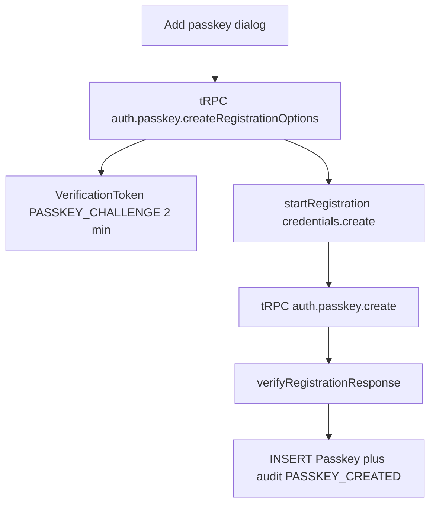

# Phase 2e task 4a: Documenso passkey registration

Repo `D:\Jayami\Portfolio\p1-web-e2e-ci`, branch `feat/2026-10-11-p1-phase2e-documenso-2fa`, head `d976129` (matches). Documenso source read at `products/documenso` `f4105e47`. Working tree at planning time: `git status --short` clean. Status: plan only. Do not build the test in this task.

"Verified in source" means read from code. "Predicted" means confirm live before encoding it.

## Decision: stop. 127.0.0.1 is not a valid RP ID

`getAuthenticatorOptions` ([packages/lib/utils/authenticator.ts](D:/Jayami/Portfolio/products/documenso/packages/lib/utils/authenticator.ts)) sets:

- `rpId` = `new URL(NEXT_PUBLIC_WEBAPP_URL()).hostname`
- `origin` = the full `NEXT_PUBLIC_WEBAPP_URL()` (scheme + host + port)

The harness sets `NEXT_PUBLIC_WEBAPP_URL` to the Documenso base URL, `http://127.0.0.1:3001` ([qa-portfolio-harness/src/adapters/documenso-env.ts](D:/Jayami/Portfolio/qa-portfolio-harness/src/adapters/documenso-env.ts) `buildDocumensoAppEnv`). That value wins over the fork `.env`. So the running app's RP ID is `127.0.0.1` and the expected origin is `http://127.0.0.1:3001`.

WebAuthn requires the RP ID to be a valid domain string (W3C WebAuthn, Relying Party identifier). A domain is not an IPv4 or IPv6 address. `localhost` is the one non-public host the spec allows. Chromium rejects an IP RP ID with `SecurityError` before `navigator.credentials.create` returns. `@simplewebauthn/server` documents `rpID` as a "valid domain name". The page being a trustworthy origin (`http://127.0.0.1` is a secure context) does not make the RP ID valid.

There is no passkey feature flag. Nothing in `packages/lib/constants/auth.ts` disables passkeys. Registration options are `residentKey: 'preferred'`, `userVerification: 'preferred'` (library defaults; Documenso does not pass `authenticatorSelection`). `verifyRegistrationResponse` defaults `requireUserVerification` to `true`, so the authenticator must set the UV flag. The requested virtual authenticator (`ctap2`, `internal`, `hasResidentKey`, `hasUserVerification`, `isUserVerified`) matches that. `attestationType` is `none`. Timeout is `PASSKEY_TIMEOUT` (60s). `MAXIMUM_PASSKEYS` is 50.

`env()` reads `process.env` on the server and `window.__ENV__` in the browser. `createPublicEnv()` in the root loader injects `NEXT_PUBLIC_*` per request. A rebuild is not required for this key. A process restart is, and this task must not start, stop, or rebuild Documenso. A fork `.env` edit would not stick anyway: the harness overwrites `NEXT_PUBLIC_WEBAPP_URL` from the base URL, and `documensoListen` refuses any hostname other than `127.0.0.1`.

### Smallest fix (env only, no fork edit) — not done in this task

The ceremony origin, the `Origin` header, and `NEXT_PUBLIC_WEBAPP_URL` must be the same host. The auth middleware returns 403 when `Origin` does not match that URL. Pointing the browser at a different host while the process still has `127.0.0.1` fails closed.

Do not use `localhost`. P1 and the harness reject it because Windows often resolves it to `::1` while the server listens on IPv4.

Proposed origin: `http://p1.lvh.me:3001`. `lvh.me` is a public name that resolves to `127.0.0.1`, so it is a valid domain, stays on IPv4, and needs no hosts file and no fork change. `rpId` becomes `p1.lvh.me`, which equals the page's effective domain.

On the next restart you allow:

- Start the Documenso process with `NEXT_PUBLIC_WEBAPP_URL=http://p1.lvh.me:3001` (and the matching internal URL). The listener can stay on `127.0.0.1:3001`.
- Set P1 `DOCUMENSO_BASE_URL` to that same origin. `assertDocumensoBaseUrl` already allows any hostname except `localhost`. Leave `DOCUMENSO_DB_URL` on `127.0.0.1`.
- The harness `documensoListen` check still refuses a non-`127.0.0.1` base URL, so the restart cannot go through `adapter.up()` until that check is relaxed in the harness repo. Until then, start the already-built server by hand with the env var set. No Documenso source change.

Confirm DNS for `p1.lvh.me` once before relying on it. If it does not resolve, stop again; do not fall back to `localhost`.

Everything below is the build spec for after that restart. Do not write it while the RP ID is still `127.0.0.1`.

## Registration flow (verified in source)

- Options and create are authenticated tRPC mutations ([create-passkey-registration-options.ts](D:/Jayami/Portfolio/products/documenso/packages/lib/server-only/auth/create-passkey-registration-options.ts), [create-passkey.ts](D:/Jayami/Portfolio/products/documenso/packages/lib/server-only/auth/create-passkey.ts)). They are not the Hono `/api/auth/passkey` route. That route is sign-in only.
- `excludeCredentials` is the user's existing passkey ids (base64url). The server does not reject a duplicate `credentialId` itself.
- On success the challenge rows for that user are deleted, then one `Passkey` row is inserted with `counter` from `credential.counter`.

UI ([passkey-create-dialog.tsx](D:/Jayami/Portfolio/products/documenso/apps/remix/app/components/dialogs/passkey-create-dialog.tsx), [security.passkeys.tsx](D:/Jayami/Portfolio/products/documenso/apps/remix/app/routes/_authenticated+/settings+/security.passkeys.tsx)): Settings > Security has a link "Manage passkeys" to `/settings/security/passkeys`. That page heading is "Passkeys" and the trigger is "Add passkey". The dialog field label is "Passkey name" (`ZNameSchema`: trim, 2 to 100 chars, no URL). Submit is "Continue". Success toast text is "Successfully created passkey". The dialog does not invalidate `auth.passkey.find`. The table only loads on query. After create, re-open `/settings/security/passkeys` before asserting the row. That is one navigation, not a retry.

## Predicted bugs (no test.fail on 001)

001 is the happy path and should pass once the origin is valid. Do not add `test.fail`.

- Not a bug: user verification is required (simplewebauthn default `true`). `counter` is stored. No env flag skips passkeys.
- No unique index on `Passkey.credentialId` (schema lines 130-145). `excludeCredentials` is the only duplicate guard, and it is client-side. A second insert of the same id would succeed if the client skipped the exclude list. Not exercised by 001. Record it for a later case; do not invent `P7-OBS-DOC-PK-*` without a failing run.
- Sign-in lookup (out of scope, for 4b): [passkey.ts](D:/Jayami/Portfolio/products/documenso/packages/auth/server/routes/passkey.ts) loads the row with `Buffer.from(id, 'base64')` while registration stored `isoBase64URL.toBuffer`. base64 and base64url differ. Do not test sign-in here.
- The passkey table does not refresh until the route is loaded again. Report that as a finding, not a known-bug failure. The oracle is the row visible after a fresh `goto`.

## Rate limits

- `passkeyRateLimit` is max 10 per IP per 15 minutes, and only on `POST /api/auth/passkey/authorize`. 001 never calls it.
- Registration is tRPC. `apiTrpcRateLimit` is max 100 per IP per 1 minute on `/api/trpc/*`. One test is two mutations plus the list query.
- The shared cap that matters is still login: `loginRateLimit` globalMax 50 per IP per 15-minute wall-clock bucket. 001 uses one `loginViaApi` (password only, 2FA off).

Current `@2fa` suite at `d976129` is 23 authorize calls (8 enrolment logins, 2 in 001, 6 from the three UI second-factor tests, 7 from the API tests including disable). `@passkey` twice is 2. One `@2fa` plus two `@passkey` is 25 of 50 in a fresh bucket. They fit. They do not fit on top of a bucket already filled by earlier 2FA runs. Read the current `auth.login` IP row before the gate and wait for the next bucket if `current + 25` would pass 50. Do not set `DANGEROUS_BYPASS_RATE_LIMITS`.

## Fixture and teardown

New fixture `virtualAuthenticator` on the Documenso test, Chromium only:

- `page.context().newCDPSession(page)`
- `WebAuthn.enable` with `enableUI: false`
- `WebAuthn.addVirtualAuthenticator` with `protocol: ctap2`, `transport: internal`, `hasResidentKey: true`, `hasUserVerification: true`, `isUserVerified: true`, `automaticPresenceSimulation: true` (so Continue does not open a prompt)
- Teardown: `WebAuthn.removeVirtualAuthenticator`, then detach the session, in `finally`

Account is the existing `documensoUser` (no 2FA). Login with `loginViaApi(page.request, ...)` so the session cookie is on the page. One password login, assert 201.

`Passkey.userId` references `User` with `onDelete: Cascade`. `VerificationToken` does too. `deleteDocumensoQaUserInTransaction` deletes `"User"` by id, so passkey rows and challenge tokens go with the user. Sweep uses the same delete. No new teardown.

Leak script: add `countDocumensoQaPasskeys()` — `SELECT count(*)::int FROM "Passkey" p JOIN "User" u ON u.id = p."userId" WHERE u.email LIKE 'qa-%@qa.local'`. Print it next to `rateLimitRows`. Unlike rate-limit rows, a leftover passkey is a credential leak: exit 1 when the count is greater than 0. Users and orphans stay as they are.

## Test P1-DOC-PK-001

File `tests/documenso/auth/passkey-register.spec.ts`. Tag `["@documenso", "@auth", "@passkey"]`. Annotations `testId` `P1-DOC-PK-001`, priority P1. It lives under `tests/documenso`, so only the `documenso-chromium` project collects it. Always run via `npm run test:documenso` so Cal is not selected.

Name the passkey `QA passkey` (do not keep the UA default).

Steps, one path, no sleeps, retries, or conditionals:

1. Attach the virtual authenticator, then `loginViaApi`.
2. Open `/settings/security`. Click the link "Manage passkeys". Heading "Passkeys" is visible.
3. Click "Add passkey". Dialog name "Add passkey". Fill "Passkey name". Click "Continue".
4. Toast "Successfully created passkey" is visible. Dialog is gone.
5. `goto` `/settings/security/passkeys` again. Cell "QA passkey" is visible.
6. `WebAuthn.getCredentials` returns exactly one credential.
7. Read-only SQL: `Passkey` count for this user id is 1.

Locators, in order: `getByRole('link', { name: 'Manage passkeys' })`, `getByRole('heading', { name: 'Passkeys' })`, `getByRole('button', { name: 'Add passkey' })`, `getByRole('dialog', { name: 'Add passkey' })`, `dialog.getByLabel('Passkey name')`, `dialog.getByRole('button', { name: 'Continue' })`, `getByText('Successfully created passkey')` (use a `status` role if the toast has one), `getByRole('cell', { name: 'QA passkey' })`. No CSS, XPath, `.first()`, `.nth()`, or `.last()`.

## Files (after the origin fix only)

- New: `tests/documenso/auth/passkey-register.spec.ts`, `src/products/documenso/pages/passkeys.page.ts` (security link, dialog, table cell).
- Edit: `src/products/documenso/env.ts` (route `/settings/security/passkeys`), `src/products/documenso/fixtures.ts` (`virtualAuthenticator`), `src/products/documenso/qa-user.ts` (`countDocumensoQaPasskeys`), `scripts/count-documenso-qa-leaks.mts`.
- Not added: dependency, fork edit, markdown other than this plan, `test.fail`, a sign-in test.

## Checks (only after the origin restart)

One Playwright process at a time. Health first: `GET /signin` and `GET /api/auth/csrf` on the new origin, both 200. Never touch Cal.

1. `npm run test:documenso -- --grep "P1-DOC-PK-001"`
2. Gate: `npm run test:documenso -- --grep "@passkey"` twice, then `npm run test:documenso -- --grep "@2fa"` once.
3. `npx tsx scripts/count-documenso-qa-leaks.mts` exits 0 (`users` 0, orphans 0, `passkeys` 0). `rateLimitRows` is printed and does not fail the script.
4. `npm run check` (lint, prettier, typecheck, actionlint) passes.
5. Commit explicit paths. `git push origin feat/2026-10-11-p1-phase2e-documenso-2fa`. No PR.

If `git status` shows anything besides this plan when the build starts, show the diff and do not fold it into the passkey commit.

## This planning step

Write this plan to [docs/plans/2026-10-11-phase-2e-task4a-passkey-register.md](docs/plans/2026-10-11-phase-2e-task4a-passkey-register.md). Do not add the spec, fixture, or leak-script change until the origin fix is approved and Documenso has been restarted onto it.

## Review changes (2026-10-11)

The origin fix is done in harness v0.2.4. `DOCUMENSO_PUBLIC_URL=http://p1.lvh.me:3001` is the public origin (`NEXT_PUBLIC_WEBAPP_URL` and the Playwright `baseURL`). The internal URL and the listen address stay `127.0.0.1:3001`. A hosts-file line `127.0.0.1 p1.lvh.me` pins IPv4. The manual-start option in the section above is dropped: restart goes through the harness, not a hand-started server.
