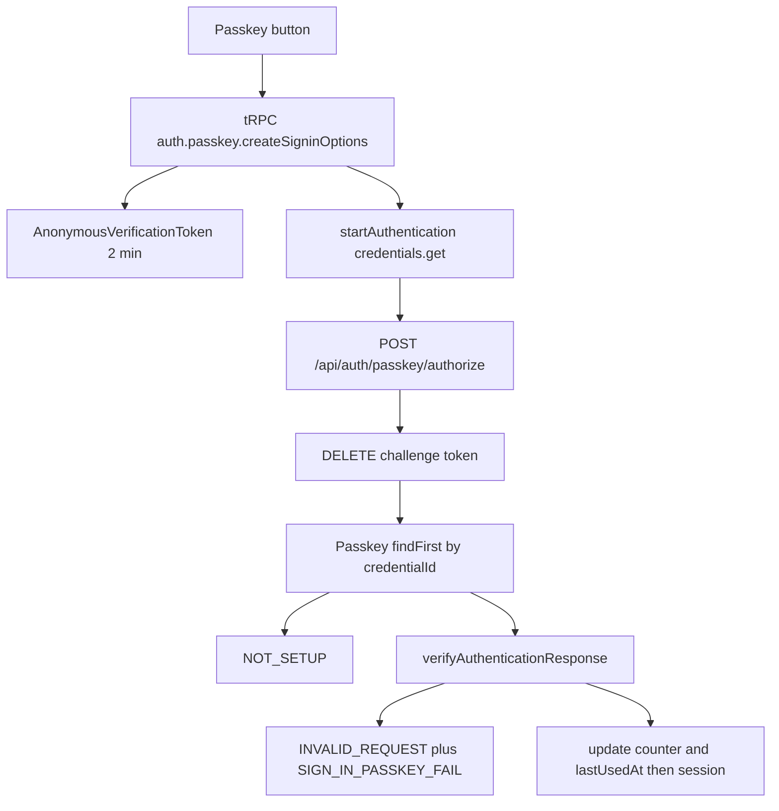

# Phase 2e task 4b: Documenso passkey sign-in

Repo `D:\Jayami\Portfolio\p1-web-e2e-ci`, branch `feat/2026-10-11-p1-phase2e-documenso-2fa`, head `42cf7d2`. Documenso source `products/documenso` `f4105e47`. Public origin `http://p1.lvh.me:3001`. Status: plan only. Do not start, stop, or rebuild Documenso.

"Verified in source" is from code. "Predicted" is confirmed live before it becomes an assertion.

## 1. Sign-in path (verified in source)

- Options: [create-passkey-signin-options.ts](D:/Jayami/Portfolio/products/documenso/packages/lib/server-only/auth/create-passkey-signin-options.ts). Unauthenticated tRPC. `userVerification: 'preferred'`. No `allowCredentials` (discoverable / resident key). Challenge stored on `AnonymousVerificationToken` keyed by a `nanoid` `sessionId`, TTL 2 minutes.
- Authorize: [passkey.ts](D:/Jayami/Portfolio/products/documenso/packages/auth/server/routes/passkey.ts) `POST /api/auth/passkey/authorize` with `{ csrfToken: sessionId, credential: JSON.stringify(assertion) }`.
- UI: [signin.tsx](D:/Jayami/Portfolio/products/documenso/apps/remix/app/components/forms/signin.tsx) button label **Passkey**. Success calls `handleSignInRedirect` to `/` (then the app routes to documents). Failure toast title **Something went wrong**.

Same-context rule from 4a: the CDP virtual authenticator lives on the Playwright `page` context. Sign-out and the later passkey get must use that page. A new `browser.newContext()` drops the credential.

### Credential id lookup (ruled out on Node 24)

Registration stores `Buffer.from(isoBase64URL.toBuffer(credential.id))` ([create-passkey.ts](D:/Jayami/Portfolio/products/documenso/packages/lib/server-only/auth/create-passkey.ts) line 93). Authorize looks up `Buffer.from(requestBodyCredential.id, 'base64')` (passkey.ts line 73). WebAuthn `id` is base64url, so ids can contain `-` and `_`.

On Node 24.21.0 (Documenso's required major), `Buffer.from(s, 'base64')` and `Buffer.from(s, 'base64url')` produced the same bytes for `'abc-def_ghi'`, `'____'`, and `'----'`. The 4a prediction does not hold on this runtime. A virtual authenticator's random id is therefore not a flake source for 002.

Do not add `test.fail`, do not branch on whether the id contains `-`/`_`, do not inject `WebAuthn.addCredential`. If 002 fails with `NOT_SETUP`, capture the live `credential.id` and the DB `credentialId` hex before calling it a product bug.

On older Node that skipped URL-safe characters, ids containing `-` or `_` would have missed. That is not this stack.

### Challenge: single-use (verified)

`anonymousVerificationToken.delete({ where: { id: csrfToken } })` runs before lookup. A second authorize with the same `sessionId` gets `INVALID_REQUEST`. The token is consumed even when the passkey is missing (003 burns the challenge, then returns `NOT_SETUP`). Expiry is 2 minutes (`EXPIRED_CODE`).

### SignCount / clone detection (verified)

`verifyAuthenticationResponse` defaults `requireUserVerification: true`. Counter check (simplewebauthn): if either stored or authenticator counter is greater than 0, and authenticator `counter <= stored`, verification throws. Documenso then stores `verification.authenticationInfo.newCounter` and `lastUsedAt`. Clone detection is implemented. Registration counter is typically 0; Chrome's virtual authenticator usually increments `signCount` on get.

002 oracles (both required):

- `WebAuthn.getCredentials` `signCount` after sign-in is greater than the value recorded after register.
- DB `"Passkey"."counter"` for this user equals that new `signCount` (read as integer).

If Chrome does not increment, 002 fails loudly. Do not weaken the oracle and do not `test.fail`.

### Deleted passkey (verified, status predicted)

[delete-passkey.ts](D:/Jayami/Portfolio/products/documenso/packages/lib/server-only/auth/delete-passkey.ts) deletes the row by passkey id. The virtual authenticator still holds the cred, so `credentials.get` succeeds. Lookup finds nothing and throws `AppError(AuthenticationErrorCode.NotSetup)` (`NOT_SETUP`). UI maps that to: **This passkey is not configured for this application. Please login and add one in the user settings.**

`AppError` has no `statusCode`. `auth.onError` returns `err.statusCode || 500`. Predicted HTTP 500 with `{ code: "NOT_SETUP" }`, same family as the 2FA 500s. Code proves the status. Do **not** put `test.fail` on 003: that would pass if a session were created. 003 asserts `NOT_SETUP`, the toast text, URL still `/signin`, and `isAuthenticated === false`. Record the live HTTP status in the report as `P7-OBS-DOC-PK-001` (auth failure 500). Do not add PK-004 in this task.

## 2. Rate limits

- Email-password login: 50 per IP per 15 m. 002 and 003 each do one `loginViaApi` (register while logged in).
- Passkey authorize: `passkeyRateLimit` max 10 per IP per 15 m. 002 one success, 003 one failure. Both count.
- tRPC: 100 per IP per 1 m (options + create + find + delete). Not the bottleneck.

`@passkey` at three tests: 001 = 1 login, 002 = 1 login + 1 passkey, 003 = 1 login + 1 passkey. One `@passkey` run = 3 logins + 2 passkey. Twice = 6 logins + 4 passkey. One `@2fa` = 23 logins. Gate total = 29 of 50 logins and 4 of 10 passkey in a **fresh** bucket. They fit. They do not fit on a bucket already used by earlier runs. Read the current `auth.login` IP count and `auth.passkey` IP count before the gate. Do not set `DANGEROUS_BYPASS_RATE_LIMITS`.

## 3. Tests

Reuse `documensoUser` + `virtualAuthenticator` (already in [fixtures.ts](src/products/documenso/fixtures.ts)). Reuse [PasskeysSettingsPage.createPasskey](src/products/documenso/pages/passkeys.page.ts). Empty `storageState`. Tag `["@documenso","@auth","@passkey"]`. File [tests/documenso/auth/passkey-signin.spec.ts](tests/documenso/auth/passkey-signin.spec.ts). Name `QA passkey`.

Shared enrol steps (inline helper in the spec, not a new fixture): API password login on `page.request`, security -> Manage passkeys, create named passkey, toast, then `gotoPasskeys` so the row is visible. Same as 001.

**P1-DOC-PK-002** (P1): enrol, record `signCount` and DB counter, Sign Out in this context, `/signin`, click **Passkey**, wait for `POST .../passkey/authorize`. Oracles: authorize 200, session email matches, `signCount` increased, DB `counter` equals new `signCount`.

**P1-DOC-PK-003** (P1): enrol, Delete in settings (dialog **Delete passkey**), toast **Passkey has been removed**, `gotoPasskeys` and the name cell gone, DB count 0, Sign Out, click **Passkey**. Oracles: body `code === NOT_SETUP`, toast description as above, still `/signin`, `readSession` `isAuthenticated === false`, no session cookie. Do not assert HTTP status.

No sleeps, retries, or `if` oracles. One path each.

### Locators

- Passkey: `getByRole('button', { name: 'Passkey', exact: true })`.
- Authorize: `waitForResponse` POST URL includes `/api/auth/passkey/authorize` (add `DOCUMENSO_ROUTES.passkeyAuthorize`).
- Sign out: the org menu trigger has `data-testid="menu-switcher"` and no accessible name ([org-menu-switcher.tsx](D:/Jayami/Portfolio/products/documenso/apps/remix/app/components/general/org-menu-switcher.tsx) line 127). Use `getByTestId('menu-switcher')`. Keep that locator in the page object only (do not use it from the spec). Log it as an accessibility finding (`P7-OBS-DOC-A11Y-PK` or equivalent in the final report). Then `getByRole('menuitem', { name: 'Sign Out' })`. Wait for `/signin`.
- Delete: `getByRole('button', { name: 'Delete' })` on the one-row table, then `getByRole('dialog', { name: 'Delete passkey' }).getByRole('button', { name: 'Delete' })`.
- Error: prefer `getByRole('status')` / `alert`; else `getByText` for the NotSetup sentence.

### Teardown and leak

`Passkey.userId` and `VerificationToken.userId` cascade on User delete. Existing `teardownDocumensoQaUserById` is enough. `AnonymousVerificationToken` has no user FK; authorize deletes it. Leak script already fails on leftover QA passkeys (`passkeys > 0`). No leak-script change unless 002/003 introduce a new leftover table (they should not).

New read-only helper: `readDocumensoPasskeyCounter(userId)` returns the single row's `counter` as number, or throws if the count is not 1.

## 4. Predicted product bugs

- No `test.fail` on 002 or 003.
- `P7-OBS-DOC-PK-001`: `NOT_SETUP` (and other auth AppErrors) returned as HTTP 500. Proven in `onError`. Evidence is the 003 authorize status. Findings log only.
- Menu trigger unnamed: a11y finding, not a login blocker.
- Unique `credentialId` still missing (4a). Out of scope.
- Do not invent a lookup bug.

## 5. P1-DOC-2FA-001 timeout (own small fix)

Symptom: timeout waiting for `twoFactorSetup` POST, twice, only in the full `@2fa` run. Do not call it cold start.

The waiter in [security.page.ts](src/products/documenso/pages/security.page.ts) `openEnableTwoFactorFlow` requires `response.ok()`. A non-OK POST never matches, so Playwright reports a timeout instead of the status.

Forensic, in order:

1. Find the failing traces (`test-results/**/trace.zip` or the HTML report). If they are gone, reproduce with `npm run test:documenso -- --grep "@2fa"` once (counts as 23 logins).
2. In the 001 trace, Network: was `POST /api/auth/two-factor/setup` sent?
   - **No POST:** click did not run the handler (hydration, overlay, wrong button). Screenshot and action log. Product or test accordingly.
   - **POST 500 or 429:** stop. Report PRODUCT BUG or environment limit with the status, body `code`, and trace path. Do not change the waiter, do not lengthen the timeout, and do not fold this into the passkey commit.
   - **POST other non-2xx:** TEST BUG. The `ok()` filter hid the status. Fix: wait on method + URL only, then assert the success status. Surface body `code` in the error, same pattern as `submitEnrolmentToken`. That waiter-only fix is a separate commit from 002/003 if it happens.
   - **POST 200 but waiter missed:** URL mismatch. Fix the matcher; do not lengthen the timeout.
3. Label PRODUCT BUG or TEST BUG with that evidence. Only then change code. No longer timeout, no retry.

## 6. Files

New: [tests/documenso/auth/passkey-signin.spec.ts](tests/documenso/auth/passkey-signin.spec.ts).

Edit: [signin.page.ts](src/products/documenso/pages/signin.page.ts) (Passkey + Sign Out; `menu-switcher` test id stays in the page object), [passkeys.page.ts](src/products/documenso/pages/passkeys.page.ts) (delete), [env.ts](src/products/documenso/env.ts) (`passkeyAuthorize`, maybe `signout`), [qa-user.ts](src/products/documenso/qa-user.ts) (`readDocumensoPasskeyCounter`). Do not edit [security.page.ts](src/products/documenso/pages/security.page.ts) until the 001 trace is classified, and not in the passkey commit if the trace is 500/429.

Not added: dependency, fork edit, `test.fail`, extra markdown besides this plan, a fourth passkey test.

## 7. Checks

One Playwright process at a time. Health: `GET http://p1.lvh.me:3001/signin` and `.../api/auth/csrf`, both 200. Never touch Cal.

1. `npm run test:documenso -- --grep "P1-DOC-PK-002"`
2. `npm run test:documenso -- --grep "P1-DOC-PK-003"`
3. After a waiter-only 001 fix (only if the trace is not 500/429): `npm run test:documenso -- --grep "P1-DOC-2FA-001"`
4. Gate: `npm run test:documenso -- --grep "@passkey"` twice, then `npm run test:documenso -- --grep "@2fa"` once.
5. `npx tsx scripts/count-documenso-qa-leaks.mts` exit 0 (`users` 0, orphans 0, `passkeys` 0).
6. `npm run check` (lint, prettier, typecheck, actionlint) must pass.
7. Commit explicit paths. `git push origin feat/2026-10-11-p1-phase2e-documenso-2fa`. No PR.

Risk: Playwright's global test timeout is Cal prod 60s. 002 is register + sign-out + passkey get. If it hits 60s with evidence, raise `timeout` on the `documenso-chromium` project only.

If `git status` shows files besides this work, show the diff and do not fold them in.

## Review notes (2026-10-11)

- `getByTestId('menu-switcher')` is the locator because the button has no accessible name. Keep it in the page object. Log the missing name as an accessibility finding in the task report.
- If P1-DOC-2FA-001's trace shows a real 500 or 429 from `POST /api/auth/two-factor/setup`, stop and report before changing anything. Do not fold that into the passkey commit.
