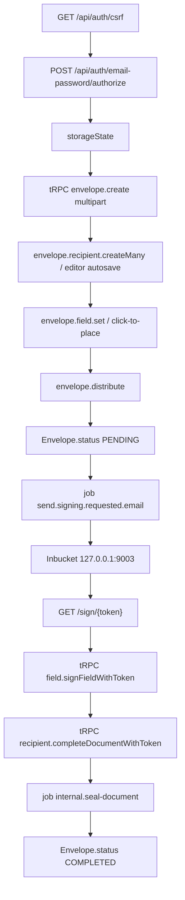

# Phase 2e task 4d: Documenso core signing flow

Repo `D:\Jayami\Portfolio\p1-web-e2e-ci`, GitHub `Jayami123/playwright-e2e-ci-framework`, code P1. Branch `feat/2026-10-11-p1-phase2e-documenso-2fa` (cited head `6e86608`). Documenso source `products/documenso` `f4105e47` at `http://p1.lvh.me:3001` (Chrome channel). Plan only. Do not start, stop, or rebuild Documenso.

Save this plan to [docs/plans/2026-10-11-phase-2e-task4d-documenso-signing-flow.md](docs/plans/2026-10-11-phase-2e-task4d-documenso-signing-flow.md) as the first implementation step. After the build, commit the plan with the code (same as 4c).

"Verified in source" means read from code. "Predicted" means confirm live before encoding it. No `test.fail` until a live run contradicts the intended security property.

## Decisions

- **QA user, not seed.** Ignore the HTML seed `example@documenso.com`. Reuse `createDocumensoQaUser` / `documensoUser`.
- **Fixture, not a setup project.** Auth specs already `test.use({ storageState: EMPTY_STORAGE })`. A `documenso-setup` project that injects project-level storageState would sign every Documenso test in as one shared user. FW-002 starts signed in via a **file-scoped fixture** that logs in once and hands Playwright a tmp `storageState` path. FW-001 independently proves csrf → authorize → save → reuse.
- **FW-003 does not share FW-002 leftover state.** Each test creates its own envelope. Shared POM helper `sendExamplePdfToRecipient` is fine; shared documents are not.
- **Type the signature** (not draw) for FW-003. Mapped case allows draw/type. Type has `placeholder="Type your signature"` and `data-testid="signature-pad-type-input"`. Draw canvas has `data-testid="signature-pad-draw"` but no accessible name. Draw stays documented for locators; the committed path is Type.
- **No README/ADR** in this task (same as 4c). P7-OBS ids and the mapped-vs-built table go in the final report.
- **2FA-001 is a separate small commit** before the FW commit.

## 1. Code reading (verified)

There is no Prisma `Document` model. UI "document" = `Envelope` with `type = DOCUMENT`. Legacy numeric id is `secondaryId`.

- **Create:** `POST` tRPC `envelope.create` multipart (`payload` JSON + `files`). Writes `DocumentMeta`, `Envelope` (DRAFT, `internalVersion: 2`), `EnvelopeItem`, `DocumentData`. [create-envelope.ts](D:/Jayami/Portfolio/products/documenso/packages/lib/server-only/envelope/create-envelope.ts). UI: documents list dropzone `role="button"` heading **Add a document** ([document-dropzone.tsx](D:/Jayami/Portfolio/products/documenso/packages/ui/primitives/document-dropzone.tsx) line 79).
- **Recipient:** empty envelope already has one blank SIGNER row ([use-editor-recipients.ts](D:/Jayami/Portfolio/products/documenso/packages/lib/client-only/hooks/use-editor-recipients.ts) lines 187–199). Do **not** click **Add Signer** unless live shows zero rows (that would create a second empty row and block send). Token = `nanoid()`, indexed. Email `aria-label="Email"`, name `aria-label="Name"` ([recipient-row.tsx](D:/Jayami/Portfolio/products/documenso/apps/remix/app/components/general/envelope-editor/recipient-row.tsx)).
- **Signature field:** palette button **Signature**, then `window` `mouseup` on `.react-pdf__Page` ([envelope-editor-fields-drag-drop.tsx](D:/Jayami/Portfolio/products/documenso/apps/remix/app/components/general/envelope-editor/envelope-editor-fields-drag-drop.tsx)). V2 send auto-inserts _existing_ field text, it does **not** create a missing signature field. Send is blocked with `MISSING_SIGNATURES` if none placed.
- **Send:** `envelope.distribute` → `sendDocument` sets `PENDING` immediately ([send-document.ts](D:/Jayami/Portfolio/products/documenso/packages/lib/server-only/document/send-document.ts) line 321). Then job `send.signing.requested.email`. Link is **`${NEXT_PUBLIC_WEBAPP_URL()}/sign/${token}`** ([send-signing-email.handler.ts](D:/Jayami/Portfolio/products/documenso/packages/lib/jobs/definitions/emails/send-signing-email.handler.ts) line 168), not the request Host. Default subject **Please sign this document**. CTA **View Document to sign**. Recipient `expiresAt` default 3 months. UI: **Send Document** then dialog submit **Send**.
- **Jobs:** harness sets `NEXT_PRIVATE_JOBS_PROVIDER=local` ([documenso-env.ts](D:/Jayami/Portfolio/qa-portfolio-harness/src/adapters/documenso-env.ts) line 241). Local provider inserts `BackgroundJob` then HTTP-posts to `NEXT_PRIVATE_INTERNAL_WEBAPP_URL`. Email and seal are async. **No SLA in code.** Poll. Inbucket SMTP is `127.0.0.1:2525`, API/UI `127.0.0.1:9003`.
- **Sign:** `/sign/:token`. Invalid/DRAFT → 404. Already signed → `/complete`. Field click opens signature pad. Complete dialog submit for SIGNER is **Sign** ([document-signing-complete-dialog.tsx](D:/Jayami/Portfolio/products/documenso/apps/remix/app/components/general/document-signing/document-signing-complete-dialog.tsx) line 387). Heading on complete page: **Document Signed** (line 185). Envelope `COMPLETED` is set in `internal.seal-document`, not in complete. Complete page polls `envelope.signingStatus` (`token` in input): PENDING / PROCESSING / COMPLETED. Owner poll: authenticated `envelope.get` → `status`.
- **Authz (for extras):** complete binds `recipients.some({ token })` plus matching document id. Wrong pair → `NOT_FOUND` 404. Already signed → `RECIPIENT_ALREADY_SIGNED` (router idempotent). Concurrent complete: `updateMany` where `signingStatus not SIGNED`; loser count 0 → same code ([complete-document-with-token.ts](D:/Jayami/Portfolio/products/documenso/packages/lib/server-only/document/complete-document-with-token.ts) lines 318–344). Owner routes are `authenticatedProcedure` (session). Recipient mutations are token-in-body. Cancel → `CANCELLED` → complete throws `ENVELOPE_CANCELLED`. Pending delete is **hard** delete ([delete-document.ts](D:/Jayami/Portfolio/products/documenso/packages/lib/server-only/document/delete-document.ts) line 185) → link 404. Expired: `assertRecipientNotExpired`. Tampered nanoid → 404.
- **CSRF:** auth routes only. Envelope/sign tRPC does not use the auth CSRF cookie.
- **Cascade:** `Team.organisationId` Cascade, `Envelope.teamId` Cascade, `Envelope.userId` Cascade, Recipient/Field/EnvelopeItem Cascade. Current teardown `DELETE Organisation` then `User` **does cascade envelopes**. `DocumentMeta` has **no** onDelete from Envelope (FK sits on Envelope). `DocumentData` cascade is the other way (`EnvelopeItem → DocumentData`). Predicted leftovers after user delete: orphan `DocumentMeta` and `DocumentData`, plus `BackgroundJob` rows (no user FK), `DocumentAuditLog.envelopeId` SetNull. Confirm live in the first FW-002 teardown, then lock leak-script fail conditions.

## 2. Mapped tests

### P1-DOC-FW-001 API sign-in produces storageState (P0, `@documenso @fw`)

Empty `storageState`. `documensoUser`. Steps: `loginViaApi` (already GET csrf then POST authorize), `page.context().storageState({ path })` under `os.tmpdir()` (same as Cal FW-001, not `test-results`), `browser.newContext({ storageState })`, open `/t/${teamUrl}/documents`, assert heading **Documents**, `GET /api/auth/session` email matches, `hasSessionCookie`. Delete tmp in `finally`.

**teamUrl must be returned** from `createDocumensoQaUser` (today it is generated as `prefixedId("personal")` and discarded). Add `teamUrl` (and `teamId` if cheap) to the fixture record.

Secrets: `.auth/` already gitignored. Do not write this state under the repo. Do not log cookies. Setup-style traces stay off if any setup file is added (none planned).

### P1-DOC-FW-002 Upload, add recipient, send (P0)

Uses `signedInDocumensoUser` so `page` is already authed. Recipient `qa-<run>-w${worker}-${token}@example.test` (Faker via existing factory helpers; not a User row). File [assets/example.pdf](assets/example.pdf): tiny valid PDF whose **visible text** is unique (`P1 Documenso example`) so field placement can `getByText` the text layer (no CSS).

POM:

- `DocumentsPage.upload(pdfPath)` — `getByRole("button", { name: "Add a document" })` then `setInputFiles` on the dropzone file input. Wait for editor (`Document Editor` / URL `/t/.../documents/.../edit`).
- `EditorPage.addSigner(email, name)` — fill existing blank row `getByLabel("Email")` / `getByLabel("Name")`. Confirm live one row. Wait for autosave (web-first: email value sticks, or tRPC `envelope.recipient` response).
- `EditorPage.addSignatureField()` — `getByRole("button", { name: "Add Fields" })` (step `data-testid="envelope-editor-step-addFields"` is allowed as 3rd priority if the role name is ambiguous). Click **Signature**. Click the PDF via `getByText("P1 Documenso example")` bounding box (mouseup is what the editor listens for). Wait until send is allowed (dialog no longer `MISSING_SIGNATURES`).
- `EditorPage.send()` — **Send Document**, dialog **Send**. Wait for `envelope.distribute` success.

Oracle: documents table / editor badge **Pending** (`FRIENDLY_STATUS_MAP.PENDING` = `Pending`). Independent: SQL or `envelope.get` `status === "PENDING"`. Inbucket: poll until a message exists for that mailbox, body contains `/sign/` and origin equals `loadDocumensoConfig().baseUrl` (`http://p1.lvh.me:3001`). `expect.poll`, no `waitForTimeout`.

### P1-DOC-FW-003 Recipient signs from the email link (P0)

Same helper to send. Parse signing URL from Inbucket (HTML then text). Open in **`browser.newContext()`** with empty storage (no owner session).

- Click field labelled **Signature** (`getByText("Signature")` on the empty field).
- Dialog: tab **Type**, fill placeholder/testid, confirm (live button name).
- Complete: trigger then dialog **Sign**.
- Assert heading **Document Signed**.
- Owner: `expect.poll` `envelope.get` until `status === "COMPLETED"`, then UI **Completed**. That wait covers the local seal job. Do not assert a duration.

## 3. Extra primitives (keep; all supported in source)

Host check lives in FW-002/003, not a separate id.

Build these in [tests/documenso/fw/signing-primitives.spec.ts](tests/documenso/fw/signing-primitives.spec.ts). Same `@fw` tag. Confirm live before `test.fail`. Code predicts **refusals that pass**.

- **P1-DOC-FW-004** reuse link after complete. Open `/sign/{token}` again (fresh context). Expect `/complete` and heading **Document Signed**. Second `completeDocumentWithToken` → `ALREADY_SIGNED`. No second seal. If live still completes/seals twice: `test.fail` + `P7-OBS-DOC-FW-001`.
- **P1-DOC-FW-005** token from envelope A on envelope B. `completeDocumentWithToken` with B's documentId + A's token → `NOT_FOUND`. If it signs B: `test.fail` + `P7-OBS-DOC-FW-002`.
- **P1-DOC-FW-006** two parallel completes. Two `APIRequestContext`s, same token, after the field is signed. One success, one `ALREADY_SIGNED`. SQL: recipient `SIGNED` count 1, envelope not double-sealed. If both succeed: `test.fail` + `P7-OBS-DOC-FW-003`.
- **P1-DOC-FW-007** tampered token. `/sign/{token}x` → 404. Cheap.
- **P1-DOC-FW-008** expired token. SQL `UPDATE Recipient SET expiresAt = NOW() - interval '1 hour'` after send, before open. Expect `/sign/.../expired` (or 404). No sleep.
- **P1-DOC-FW-009** owner **deletes** pending, recipient opens link → 404.
- **P1-DOC-FW-010** owner **cancels** (void), recipient complete → `ENVELOPE_CANCELLED` / cancelled UI. Distinct from 009.
- **P1-DOC-FW-011** owner-only `envelope.get` with an empty recipient context (no session) → unauthenticated (predicted 401). Token in body does not satisfy `authenticatedProcedure`. If it returns the envelope: `test.fail` + `P7-OBS-DOC-FW-004`.

Drop none of these unless live shows the product already blocks in a way that makes the test a no-op duplicate of another. Do not add fork changes.

## 4. Locators (semantic; confirm live before writing)

Priority: `getByRole` > `getByLabel` > `getByTestId` > `getByText`. No CSS, XPath, `.first()/.nth()/.last()`.

- Upload: `getByRole("button", { name: "Add a document" })`. Hidden file input via that control's `setInputFiles`.
- Signer: `getByLabel("Email")`, `getByLabel("Name")`. **Add Signer** only if live has zero rows.
- Fields step: role/name **Add Fields**, else `getByTestId("envelope-editor-step-addFields")`.
- Place field: `getByRole("button", { name: "Signature" })` then mouse on `getByText("P1 Documenso example")` box.
- Send: `getByRole("button", { name: "Send Document" })`, dialog `getByRole("button", { name: "Send", exact: true })`.
- Status: `getByText("Pending"|"Completed", { exact: true })` scoped to the row/badge, plus API oracle.
- Sign pad: `getByRole("tab", { name: "Type" })`; input `getByPlaceholder("Type your signature")` or `getByTestId("signature-pad-type-input")`. Draw fallback: `getByTestId("signature-pad-draw")`, `boundingBox()`, `mouse.move` / `down` / `up` along the box (no CSS selector). **Clear Signature** exists as a `<button>` with text.
- Complete: live-confirm the page trigger; dialog submit **Sign**. Result heading **Document Signed**.

A11y findings (source, confirm live): draw canvas has no accessible name (only testid); PDF page is class-selected in product code; recovery-code icon buttons already logged in 2FA.

## 5. P1-DOC-2FA-001 (own small commit)

Traces are gone (`test-results` has no `auth-2fa-P1-DOC-2FA-001-*`). Reproduce once: `npm run test:documenso -- --grep "@2fa"` after checking the login bucket.

Source cause (verified): [enable-authenticator-app-dialog.tsx](D:/Jayami/Portfolio/products/documenso/apps/remix/app/components/forms/2fa/enable-authenticator-app-dialog.tsx) lines 140–147. **Enable 2FA** is SSR-visible. Client `onClick` `preventDefault` then `handleEnable2FA()` → `POST /setup`. `goto()` uses `domcontentloaded` and only waits for the button to be **visible**. A click before hydration never sends setup. Matches "POST never sent" in the full `@2fa` file (timing), not the old `ok()` waiter (already fixed in `5ca91c0`).

Fix, same as sign-in: in `SecuritySettingsPage.goto()`, after the button is visible, wait for a **client-hydrated** control on the same page (QA users have `PasswordForm`): heading **Security**, current-password field `toBeEditable`, Enable 2FA `toBeEnabled`, then `openEnableTwoFactorFlow` registers `waitForResponse` and clicks. No longer timeout, no retry.

If the reproduce trace shows POST 500/429: stop, do not change the waiter, report PRODUCT BUG / env. If POST 200 and waiter missed: matcher bug only.

## 6. Rate limits, Inbucket, cleanup, leaks

**Login** `auth.login`: 50 / IP / 15 m. FW logins: 001 = 1, 002 fixture = 1, 003 fixture = 1, each extra = 1 (006 uses the signed-in owner plus two complete POSTs, not two logins). One `@fw` run ≈ 10 logins. Twice ≈ 20. Then `@2fa` ≈ 23 and `@passkey` ≈ 6 = 49 if squeezed into one login bucket. **Check `"RateLimit"` `action='auth.login'` IP row before each gate run.** Split across 15 m walls. Never set `DANGEROUS_BYPASS_RATE_LIMITS`.

**Passkey** bucket 10 / IP / 15 m: one `@passkey` (6) is fine; do not run `@passkey` twice in this gate.

**Document/email org quotas:** `assertOrganisationRatesAndLimits` on create and invite. Confirm the `free` `SubscriptionClaim` remaining on a QA org during the probe. If a send is dropped because of email quota, Inbucket stays empty and FW-002 must fail loudly (do not skip).

**Inbucket:** helper [src/products/documenso/inbucket.ts](src/products/documenso/inbucket.ts). Probe first: `GET http://127.0.0.1:9003/api/v1/mailbox/{localPart}` (predicted; mailbox = local-part of `qa-...@example.test`). Parse `/sign/` URL from HTML then text. **Teardown always `DELETE` that mailbox**, even on failure. Do not attach raw messages (they contain the token).

**Document cleanup:** user teardown already cascades Envelope via Team. Per-test Inbucket delete is extra. Do not delete by title on screen.

**Leak script** ([scripts/count-documenso-qa-leaks.mts](scripts/count-documenso-qa-leaks.mts)): add counts for QA `Envelope` (join `User.email LIKE 'qa-%@qa.local'`), `Recipient` on those envelopes, and unreferenced `DocumentMeta` / `DocumentData` after a QA sweep. Exit 1 on leftover envelopes/recipients (and DocumentMeta orphans if the first teardown run shows they actually leak). `BackgroundJob` count informational, like rate-limit rows. Recipients at `@example.test` are not Users; they must disappear with the envelope.

## 7. Files

New:

- `docs/plans/2026-10-11-phase-2e-task4d-documenso-signing-flow.md`
- `assets/example.pdf`
- `tests/documenso/fw/storage-state.spec.ts` (001)
- `tests/documenso/fw/signing-flow.spec.ts` (002, 003)
- `tests/documenso/fw/signing-primitives.spec.ts` (004–011)
- `src/products/documenso/pages/documents.page.ts`
- `src/products/documenso/pages/editor.page.ts`
- `src/products/documenso/pages/signing.page.ts`
- `src/products/documenso/inbucket.ts`
- `src/products/documenso/envelope-api.ts` (owner `envelope.get` poll, complete-with-token for extras)

Edit:

- [src/products/documenso/pages/security.page.ts](src/products/documenso/pages/security.page.ts) — 2FA hydration (commit 1)
- [src/products/documenso/qa-user.ts](src/products/documenso/qa-user.ts) — return `teamUrl`; leak counters; `setRecipientExpiresAt`; read envelope status
- [src/products/documenso/fixtures.ts](src/products/documenso/fixtures.ts) — `signedInStorageState` used only by FW specs (`test.extend` in the fw folder, not as default for all Documenso tests)
- [src/products/documenso/env.ts](src/products/documenso/env.ts) — `documents`, `sign`, Inbucket origin default `http://127.0.0.1:9003`, `journey` timeout (~120s)
- leak script
- FW specs `test.setTimeout(documensoTimeouts().journey)` because `playwright.config.ts` uses Cal `TIMEOUTS[webMode].test` (default **prod 60s** when `CAL_WEB_MODE` unset). Do **not** raise the global timeout (would hide 2FA-001).

Not added: dependency, fork edit, setup project, README, ADR, Cal touch.

## 8. Checks

Health: `GET http://p1.lvh.me:3001/signin` and `.../api/auth/csrf`, both 200. Never touch Cal. One Playwright process at a time. Chrome channel already set.

0. `git status --short` clean. Rate-limit SQL for `auth.login` and `auth.passkey`.
1. Probe Inbucket API + documents/editor/signing locators (browser). Leak script once on a throwaway sent envelope after user delete, to see DocumentMeta leftovers.
2. 2FA-001: reproduce `@2fa` once if still no trace; fix; `npm run test:documenso -- --grep "P1-DOC-2FA-001"`; commit 1.
3. Each new test alone, in id order: `npm run test:documenso -- --grep "P1-DOC-FW-001"` … through `011`.
4. `@fw` twice (check login bucket between runs).
5. `@2fa` once and `@passkey` once (check **both** buckets first).
6. `npx tsx scripts/count-documenso-qa-leaks.mts` exit 0.
7. `npm run check` (lint + prettier + typecheck + actionlint) must pass.
8. Explicit-path commits. `git push origin feat/2026-10-11-p1-phase2e-documenso-2fa`. No PR, merge, or tag.

## 9. Final report table (required)

For each id: mapped (yes/no), built (yes/no), extra (yes/no), live result, `test.fail` or not, P7-OBS if any.

Also: 2FA-001 trace verdict (POST absent vs present), Inbucket API paths that actually worked, cascade leftovers, login/passkey hits used, what was not verified (CI does not run Documenso; seal wall-clock; Firefox matrix out of scope).

## Review changes (2026-10-11)

1. P1-DOC-FW-006 race: after the field is signed, fire both completeDocumentWithToken calls with Promise.all. Attach both HTTP statuses and codes. Assert exactly one success and one ALREADY_SIGNED, plus SQL recipient SIGNED count = 1. If both succeed, it's a real race bug: test.fail + P7-OBS-DOC-FW-003.
2. P1-DOC-FW-008 uses a DB seam (expiresAt set in the past via SQL). Say so in the test annotation, same as PK-006.
3. If DocumentMeta/DocumentData orphans remain after user delete, log P7-OBS-DOC-FW-005 (product cleanup, low). Extend the sweep to delete them, and make the leak script fail on them only after that. Don't hide them.
4. Build order: P1-DOC-2FA-001 hydration fix as its own first commit, then FW-001 to FW-011 in id order.
