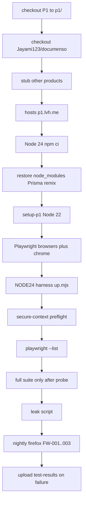

# Phase 2e task 5: Documenso CI job in P1

Repo `D:\Jayami\Portfolio\p1-web-e2e-ci`, GitHub `Jayami123/playwright-e2e-ci-framework`, code P1. Phase 2e is on `main` (PR #17, merge commit `f5575bb`). Branch `feat/2026-10-13-p1-phase2e-documenso-ci` from that `main`. Harness `qa-portfolio-harness#v0.2.5`. Status: plan only.

"Verified in source" means read from code. "Not verified" means no GitHub dispatch has run this job yet.

Never edit the Documenso fork. Never start or stop Documenso by hand. The only start path is harness `node scripts/up.mjs documenso` under Node 24.

## Decisions

- **Base:** `main` at `f5575bb` (PR #17). One feature branch for this task.
- **PR gate:** `documenso-chromium` only. `npm run test:documenso` (full project). Includes mapped FW-001..011, 2FA-001..008, PK-001..006, and already-built `P1-DOC-AUTH-000` and `P1-DOC-2FA-009`.
- **Nightly / `browser_matrix` dispatch:** same Chromium suite, then `documenso-firefox` grep `P1-DOC-FW-001|P1-DOC-FW-002|P1-DOC-FW-003`. PK-* stay Chromium-only (CDP + `channel: "chrome"`). Same policy as Cal / ADR 0008. No WebKit.
- **Retries 0** on Documenso Playwright projects only (env override). Cal keeps CI `retries: 2`. Login budget is ~41 of the 50/IP/15min cap. Document that in ADR 0011.
- **`test.fail()`:** keep only when a findings entry cites live HTTP status/body or a trace. As of this plan, none of the Documenso cases have that proof. Remove those `test.fail()` so the assertion fails for real. No new `test.fail()` unless a product bug is proven with attached evidence, only on the product assertion, with every setup step asserted first.
- **Separate job** `documenso-self-hosted`, not folded into Cal, not gated on `CAL_E2E_BASE_URL`.
- **Harness owns start.** YAML checkouts the fork, installs under Node 24, writes `/etc/hosts`, restores caches, then harness `up()`. YAML does not reimplement compose, migrate, seed, build, or Remix start.
- **Live probe first:** a `workflow_dispatch` that only starts Documenso through the harness, runs the secure-context preflight, and `--list`. No full suite. Report timings and Linux `isSecureContext`. Write the full job only after that probe is green.
- **Failure artifacts:** upload `test-results` (trace.zip, screenshots) with `if: failure()` so a red run opens in the Playwright trace viewer.
- **Free CI speedups** (no paid runners): cache Yarn/`node_modules`/Prisma client keyed on pinned product commit + lockfile; keep `~/.cache/ms-playwright` keyed on Playwright version; keep concurrency cancel-in-progress on PRs; drop `lint` from Cal/Documenso `needs` so those jobs start in parallel with lint; path filters so heavy Cal/Documenso jobs run on PRs only when their tests, config, or harness pin change. Report before/after wall-clock.
- **ADR:** [docs/adr/0011-documenso-ci.md](../adr/0011-documenso-ci.md). Task 3 reserved 0010 for 2FA.
- **Required check:** PR body must say to add `e2e / documenso-self-hosted` on `main` after the first green run. Do not rename existing checks.

## 1. How Documenso starts in CI (verified in source)

Harness does **not** checkout the fork. P1 CI must. `loadConfig()` requires an existing `PRODUCTS_ROOT/documenso` (`qa-portfolio-harness/src/config.ts` lines 103–110, 137–144).

**YAML before `up()`:**

1. Checkout this repo to `p1/` (`persist-credentials: false`).
2. Checkout `Jayami123/documenso` at `DOCUMENSO_REF` (`main`) to `products/documenso`. Capture `steps.checkout_documenso.outputs.commit`.
3. Stub empty `products/{cal,medusa,twenty-CRM}`. Do not reuse the Cal job's empty documenso stub (`e2e.yml` lines 208–212).
4. Hosts: `echo "127.0.0.1 p1.lvh.me" | sudo tee -a /etc/hosts` (harness README lines 157–170). `assertDocumensoPublicHostResolvesToLoopback` requires IPv4 `127.0.0.1` (`documenso-env.ts` lines 135–149).
5. Node **24** + `npm ci` in `products/documenso` (harness does not install; `documenso.adapter.ts` lines 118–122). Product `engines.node >= 24`, `npm >= 11.17`.
6. Restore caches (section 8).

**`DocumensoAdapter.up()`** (`documenso.adapter.ts` lines 365–424):

1. `assertDocumensoNodeVersion` — major >= 24 (`documenso-env.ts` lines 8, 279–286).
2. `assertDocumensoSigningCert` — `{productRoot}/apps/remix/example/cert.p12` (lines 216–233). Harness does not generate it.
3. If `DOCUMENSO_PUBLIC_URL` set: loopback DNS assert.
4. `composeUp` `docker/documenso.compose.yml` project `qa-harness-documenso`: Postgres `127.0.0.1:5451`, Inbucket SMTP `127.0.0.1:2525`, UI/API `127.0.0.1:9003`.
5. Probe `/signin` + `/api/auth/csrf` on listen URL; return if healthy and public URL matches.
6. `prepareProductFiles`: require `node_modules`; copy `.env.example` → `.env` if missing.
7. `migrate()`: `prisma:generate` then `prisma:migrate-deploy` (lines 427–431).
8. `seed()` if `example@documenso.com` is missing (lines 486–516).
9. `ensureBuild()`: skip only when `apps/remix/build/server/main.js` exists and `apps/remix/build/harness-build.json` `gitSha` === product `HEAD` (lines 170–188). Default build timeout 45 min/step (line 37).
10. `startWeb()`: `npm run start -w @documenso/remix`, log `.harness/documenso-web.log`, `unref()`. `down()` does not stop Remix (lines 451–453).
11. `waitReady` until both health routes 200 (default 10 min).

**App env** `buildDocumensoAppEnv` (`documenso-env.ts` lines 248–276): listen `http://127.0.0.1:3001`; `NEXT_PUBLIC_WEBAPP_URL` = public URL; SMTP 2525; `NEXT_PRIVATE_JOBS_PROVIDER=local`; signing local cert + empty passphrase. Does **not** set `DANGEROUS_BYPASS_RATE_LIMITS`.

**Node split:** save the Node 24 binary path before `setup-p1` switches PATH to Node 22. Call `"${NODE24}" p1/node_modules/qa-portfolio-harness/scripts/up.mjs documenso` with `PRODUCTS_ROOT`, `DOCUMENSO_BASE_URL`, `DOCUMENSO_PUBLIC_URL`, `DOCUMENSO_DB_URL`. Playwright then runs on Node 22. Global setup skips `up()` when already healthy (`global-setup/documenso.ts` lines 57–64). Playwright `baseURL` is the public URL (`src/products/documenso/env.ts` line 150).

## 2. Live probe first (before the full job)

Do not write the full Chromium/Firefox suite job yet. First commit is a thin `workflow_dispatch` path (`documenso_probe_only` or a dedicated probe job) that:

1. Checkouts and installs as in section 1.
2. Starts Documenso **only** via harness `up.mjs` under Node 24.
3. Runs `scripts/assert-documenso-secure-context.mts` (Chrome channel + insecure-origin flag; also record bundled Chromium headless `isSecureContext` for the ADR).
4. Runs `npx playwright test --project=documenso-chromium --list`.
5. Uploads the redacted harness log. Does not run the suite. Does not call the leak script as a gate (no QA users yet).

Report from that run: job wall-clock, npm ci, compose pull, migrate/seed, remix build vs skip, waitReady, Chrome `isSecureContext`, Chromium `isSecureContext`, `--list` count. **TBD until that dispatch.**

If `up()` or Chrome secure-context is false, stop. Do not invent YAML workarounds. Do not start Documenso outside the harness.

After that probe is green, write the full job on the same branch.

## 3. Chrome vs bundled Chromium

- `documenso-chromium` uses `channel: "chrome"` and `--unsafely-treat-insecure-origin-as-secure=<publicUrl>` (`playwright.config.ts` lines 135–148).
- Windows 2026-10-11: bundled Chromium headless keeps `isSecureContext === false`; Chrome is true (`docs/observations/documenso-passkey-e2e-notes.md` lines 5–7). Linux is the probe output.
- ubuntu-24.04 image ships Google Chrome. Still `npx playwright install chrome --with-deps` via a new `install_chrome` input on `playwright-browsers`.
- Keep Chrome unless the Linux probe proves bundled Chromium is true. PK-* stay off Firefox.

## 4. Rate limits and retries 0

Product (`packages/lib/server-only/rate-limit/rate-limits.ts`):

- Login: `max: 10` per email, `globalMax: 50` per IP, window `15m` (lines 34–39). Every authorize counts.
- tRPC: `max: 100` per IP per `1m` (lines 109–113).
- Passkey authorize: `max: 10` per IP per `15m` (lines 55–60).

Bypass `DANGEROUS_BYPASS_RATE_LIMITS === 'true'` (`rate-limit.ts` lines 73–79) is a **separate harness change** if a dispatch 429s. Not this PR. Never a fork edit. Do not set it in P1 CI.

Authorize budget (inferred from fixtures and specs):

- FW-001..011: 11
- 2FA-001..008: 21; 2FA-009: 2; AUTH-000: 1
- PK-001..006: 6
- **Chromium full project ~41** of the 50/IP/15min cap
- Nightly Firefox FW-001..003: +3 → **~44** if sequential in one job
- Full `@fw` on Firefox would be +11 → ~52, over the cap. Firefox stays 001..003.

Passkey authorize ~6/run (cap 10). workers=1 already (`playwright.config.ts` line 82).

**Retries:** global `retries: process.env.CI ? 2 : 0` stays for Cal. Both Documenso projects set `retries` from `P1_DOCUMENSO_RETRIES`, default **0**. The Documenso CI job sets `P1_DOCUMENSO_RETRIES: 0`. ADR 0011 states: 41 first-try logins leave 9 of 50; CI retries 2 on that suite could blow the bucket on a red run, so Documenso does not retry.

tRPC: observed full `@fw` browser budget ~44–46 plus ~6–7 for FW-001 (`docs/observations/documenso-signing-known-issues.md` lines 42–48). One serial job should stay under 100/min.

## 5. Existing `test.fail()` audit

Rule: cite a findings entry with HTTP status/body or a trace. No proof → remove `test.fail()` so the strict assertion fails for real. No new `test.fail()` unless a product bug is proven with attached evidence, only on the product assertion, after every setup step has been asserted.

There is no `docs/observations/documenso-2fa-known-issues.md` (task 3 deferred it to task 6). Signing and passkey observation files do not record live HTTP for the IDs below.

| Test           | Issue id           | Kind                                                                   | Findings proof in this repo                                                                       | Plan                                                                     |
| -------------- | ------------------ | ---------------------------------------------------------------------- | ------------------------------------------------------------------------------------------------- | ------------------------------------------------------------------------ |
| P1-DOC-2FA-004 | P7-OBS-DOC-2FA-003 | Unconditional `test.fail` at `2fa.spec.ts:166`                         | None. Source predicted HTTP 500 (`AppError` without `statusCode`). No saved status/body/trace.    | Remove `test.fail`. Keep 4xx assert. Report if CI is red.                |
| P1-DOC-2FA-006 | P7-OBS-DOC-2FA-001 | Unconditional at `:223`                                                | None. Runtime attachment `known-bug.json` is not a findings entry.                                | Remove `test.fail`. Keep spent-code reject assert.                       |
| P1-DOC-2FA-007 | P7-OBS-DOC-2FA-002 | Unconditional at `:274`                                                | None. `replay-totp-evidence.json` is not a findings entry.                                        | Remove `test.fail`. Keep replay reject assert.                           |
| P1-DOC-2FA-009 | P7-OBS-DOC-2FA-004 | Conditional at `:434–435` if status >= 500 or 2FA turned off           | None.                                                                                             | Remove the `if` + `test.fail`. Keep 4xx / still-enabled asserts.         |
| P1-DOC-FW-005  | P7-OBS-DOC-FW-002  | Conditional at `signing-primitives.spec.ts:116–117` if `SIGNED`        | Not in `documenso-signing-known-issues.md`.                                                       | Remove the `if` + `test.fail`. Keep `NOT_FOUND`.                         |
| P1-DOC-FW-006  | P7-OBS-DOC-FW-003  | Conditional at `:178–179` if both `SIGNED`                             | Not in observations. Race predicted, not captured.                                                | Remove the `if` + `test.fail`. Keep one `SIGNED` + one `ALREADY_SIGNED`. |
| P1-DOC-FW-011  | P7-OBS-DOC-FW-004  | Conditional at `:389–390` if HTTP 200                                  | Not in observations. Predicted 401.                                                               | Remove the `if` + `test.fail`. Keep 401.                                 |
| P1-DOC-PK-006  | P7-OBS-DOC-PK-002  | Conditional at `passkey-primitives.spec.ts:226–227` if 2xx and count 2 | Passkey notes record a **TEST BUG** in URL matching (fixed 2026-10-11), not `passkeyCount === 2`. | Remove the `if` + `test.fail`. Keep `count === 1` and `BAD_REQUEST`.     |

If a later live run proves a product bug, add `test.fail` only then: attach evidence first, assert every setup step, then `test.fail()` immediately before the product assertion, with an `issue` annotation. Do not use `browserName` conditions.

## 6. Background jobs, Inbucket, timeouts

- Jobs: `NEXT_PRIVATE_JOBS_PROVIDER=local`. Health wait is only `/signin` + `/csrf`, not seal.
- Inbucket: `expect.poll` until `${publicUrl}/sign/...` appears, timeout `journey` 120s (`inbucket.ts` lines 49–96). No `waitForTimeout`.
- FW-003 seal: `expect.poll` status `COMPLETED`, timeout `journey`. Test timeout `journey * 3` (`signing-flow.spec.ts` lines 10, 69–75).
- Teardown waits BackgroundJob PENDING/PROCESSING = 0 (`qa-user.ts` lines 373–378).

## 7. Teardown, leak gate, failure artifacts

Leak script `scripts/count-documenso-qa-leaks.mts`: exit 1 if users, org orphans, passkeys, qaEnvelopes, qaRecipients, or orphan DocumentMeta+DocumentData > 0. `rateLimitRows` informational.

Run once at job end (`if: always() && !cancelled()`, skip if `up()` failed) so a Chromium leak is visible when Firefox is skipped.

**Artifacts:**

- On **failure:** upload `p1/test-results` (`if: failure()`), including `trace.zip` and screenshots (`trace: retain-on-failure`, `screenshot: only-on-failure`). Distinct names: `playwright-test-results-documenso-chromium` / `-firefox`.
- On completed non-cancelled runs: HTML report, JUnit/JSON, redacted `documenso-web.log` (same pattern as Cal).
- `P1_PW_REPORT_ID=documenso-chromium` / `documenso-firefox` so Cal matrix JSON is not overwritten.
- Extend `nightly-alert` to summarize those JSON files. A Documenso-only red matrix run must still open `nightly-failure`.

## 8. Cache, minutes, free speedups

**Baseline (before, Cal only, not Documenso):** README cites `cal-self-hosted` warm job 5m 23s ([run 37792386085](https://github.com/Jayami123/playwright-e2e-ci-framework/actions/runs/37792386085) attempt 2) and cold 7m 9s ([run 37787015928](https://github.com/Jayami123/playwright-e2e-ci-framework/actions/runs/37787015928)). Documenso times are **TBD** from the probe dispatch and the first full dispatch. Report before/after wall-clock of the reusable workflow (PR: `lint` vs `cal-self-hosted` overlap; Documenso probe vs full).

**Caches** (restore on every run; **SAVE only** `push` to `main` + miss; no `restore-keys`):

- Cal Yarn: keep `products/cal/.yarn/cache` keyed `cal-yarn-${{ hashFiles(yarn.lock) }}`.
- Cal `node_modules` + Prisma client (`node_modules/.prisma` and Cal generate output): key `${{ runner.os }}-cal-nm-${{ steps.checkout_cal.outputs.commit }}-${{ hashFiles(yarn.lock) }}`. Skip `yarn install` on hit.
- Documenso `node_modules` + Prisma client (`node_modules/.prisma`, generated client under `packages/prisma`): key `${{ runner.os }}-documenso-nm-${{ steps.checkout_documenso.outputs.commit }}-${{ hashFiles(package-lock.json) }}`. Skip `npm ci` on hit.
- Documenso Remix `apps/remix/build`: key `${{ runner.os }}-documenso-remix-${{ steps.checkout_documenso.outputs.commit }}` (matches harness HEAD skip).
- Playwright browsers: keep existing `~/.cache/ms-playwright` keyed `${{ runner.os }}-ms-playwright-${{ playwright version }}` in `playwright-browsers/action.yml` lines 24–27.

Job timeout input `documenso_self_hosted_timeout_minutes` default 90. Probe-only timeout can be lower (30).

**Concurrency:** keep `p1-e2e.yml` group `${{ github.workflow }}-${{ github.event_name }}-${{ github.ref }}` with `cancel-in-progress` on `pull_request` (already lines 16–18). Do not cancel scheduled or dispatch runs.

**Parallel jobs:** today `cal-self-hosted` and `cal-chromium` `needs: [lint, structural]` (`e2e.yml` lines 115, 185). Drop **lint** from those `needs` (and do not add lint to Documenso). Keep `structural` on Cal jobs that read `has_live_url`. Lint, typecheck, Cal, and Documenso then overlap. Lint remains a required check.

**Path filters (PR only):** a small `changes` job (`git diff --name-only` against `github.event.pull_request.base.sha`, no new third-party action). Outputs `cal` / `documenso`.

- Cal heavy job runs if any of: `tests/cal/**`, `tests/setup/cal.setup.ts`, `src/products/cal/**`, `global-setup/index.ts`, `src/core/**`, `playwright.config.ts`, `package.json`, `package-lock.json`, `.github/workflows/**`, `.github/actions/**`.
- Documenso heavy job runs if any of: `tests/documenso/**`, `src/products/documenso/**`, `global-setup/documenso.ts`, `scripts/count-documenso-qa-leaks.mts`, `scripts/assert-documenso-secure-context.mts`, plus the same shared core/config/harness/workflow paths.
- `schedule`, `workflow_dispatch`, and `push` to `main` always run both (cache save and nightly matrix).
- `lint` / `structural` / unit always run.

## 9. Known quirks and extra checks

- Remix binds `PORT` only (`apps/remix/server/main.js` lines 47–49), so all interfaces. Health stays on `127.0.0.1`.
- `RateLimit` rows `id:qa-%` accumulate; leak script reports, does not fail.
- Orphan DocumentMeta/DocumentData: leak script fails (P7-OBS-DOC-FW-005).
- `@documenso/skia-canvas` native build on ubuntu is a probe risk. If `npm ci` fails, install documented system libs. No fork edit.
- `failOnFlakyTests` stays on when `CI` is set. Documenso retries 0, so a flake is a red fail, not retry-then-pass.
- Secure-context preflight before the suite (and as the only test-like step on the probe dispatch).
- Log `P1_DOC_FW_TRPC_BUDGET`. Do not fail the job on that number in v1.

## 10. Files to change

New:

- This plan (already this file)
- `docs/adr/0011-documenso-ci.md` (retries 0 and the ~41/50 login budget, Chrome channel, PK Chromium-only, Firefox FW-001..003, caches, path filters, leak gate, failure traces)
- `scripts/assert-documenso-secure-context.mts`

Modified:

- `.github/workflows/e2e.yml`: `DOCUMENSO_REF`; probe input then full `documenso-self-hosted`; drop lint from Cal `needs`; `changes` path filter; caches; `if: failure()` test-results upload
- `.github/workflows/p1-e2e.yml`: pass timeouts and probe/matrix inputs; nightly-alert Documenso JSON
- `.github/actions/playwright-browsers/action.yml`: `install_chrome`
- `playwright.config.ts`: Documenso project `retries` from `P1_DOCUMENSO_RETRIES` default 0; `documenso-firefox`
- `package.json`: `test:documenso:firefox`
- `tests/unit/playwright-projects.spec.ts`
- `tests/documenso/auth/2fa.spec.ts`, `tests/documenso/fw/signing-primitives.spec.ts`, `tests/documenso/auth/passkey-primitives.spec.ts`: remove unproven `test.fail()`
- `README.md`, `.env.example`

Not changed: Documenso fork, harness (unless a later 429 forces a separate harness PR).

## 11. Commands / verification

1. `git checkout main && git pull` (expect `f5575bb`). `git checkout -b feat/2026-10-13-p1-phase2e-documenso-ci`.
2. Probe YAML + preflight script. `npm run check` (actionlint). Push. `workflow_dispatch` probe-only. Paste timings and `isSecureContext`. Stop if red.
3. Remove unproven `test.fail()`. Add firefox project, retries env, leak step, failure artifact, caches, path filters, drop lint `needs`.
4. ADR 0011 + README.
5. `npm run check` again.
6. Push. Open PR. Do not merge.
7. After probe is green and full job exists: one `workflow_dispatch` with `browser_matrix: true`. Confirm Cal and Documenso matrix artifacts and that `nightly-alert` still opens/closes on `needs.e2e.result`.
8. Report before/after job minutes (baseline Cal runs above vs new PR/dispatch).
9. Ask Jayami to add required check `e2e / documenso-self-hosted`.

## 12. Final report must include

- Probe dispatch URL, step timings, Linux Chrome and Chromium `isSecureContext`, `--list` count.
- Which `test.fail()` were removed and why (no findings HTTP/trace).
- Full-suite dispatch URL, passed/failed/flaky/expected-failure, whether any 429 occurred.
- Cache hit vs miss minutes. Path-filter skip vs run. Wall-clock with lint parallel vs the old `needs: [lint, structural]` chain.
- What was not verified (WebKit, bypass flag, splitting jobs).
