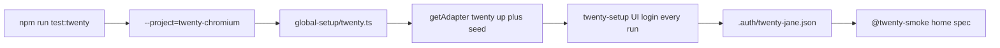

# Phase 2f task 2: wire Twenty into P1 (no tests yet)

Repo `D:\Jayami\Portfolio\p1-web-e2e-ci` · [Jayami123/playwright-e2e-ci-framework](https://github.com/Jayami123/playwright-e2e-ci-framework) · P1. Branch `feat/2026-10-13-p1-phase2f-twenty-wiring` from `main` `a56a904`. Structure/depth reference: [2026-10-11-phase-2e-task3-2fa.md](2026-10-11-phase-2e-task3-2fa.md). Status: plan only; wiring not built. Harness pin `#v0.2.7` is already on the branch (needed for the live probe).

"Verified live" means this session (2026-10-13). "Verified in source" means read from code.

## Decisions (from review and probe)

- Browser session: UI login in `twenty-setup` on every run, then reuse that run's `storageState`. Do not inject harness `authenticate()` tokens. Evidence in section 2.
- Regenerate `.auth/twenty-jane.json` on every run. `twenty-setup` always logs in. Do not skip login because a file from a previous run exists. `twenty-session` is a server-side session; a stale cookie lands on `/welcome`.
- Smoke spec asserts Jane's workspace home **and** `not.toHaveURL(/welcome/)` so a lost session fails loudly.
- Login Email/Password have no label or `aria-label` (placeholder only). Record that in `docs/observations`, not as `test.fail`.
- README notes the local ENVIRONMENT gotcha: npm skipped harness `prepare`, so `dist/` was missing.
- P1-TW-TZ-001/002/003 exist in the master plan (`p1.py`). They are tasks 4–5, out of scope here. Do not invent IDs for the smoke spec.
- No `test.fail` / `skip` / `only`. Never edit the twenty-CRM fork. Never run `docker compose` by hand.

## P1-TW-TZ cases (out of scope; tasks 4–5)

Source: master plan `p1.py`. Not implemented in this task.

| ID           | Intent                                 |
| ------------ | -------------------------------------- |
| P1-TW-TZ-001 | DATE no-shift at Honolulu / Kiritimati |
| P1-TW-TZ-002 | DATE_TIME member TZ Colombo            |
| P1-TW-TZ-003 | Group-by-day around Berlin DST         |

This task only makes P1 able to start Twenty through harness v0.2.7, hold Jane's session, and run a `twenty` Playwright project. That is the base those three cases need.

## 1. Master-plan drift

Record here, not as a product bug:

- Runtime image `twentycrm/twenty:v2.44.0`, not the fork git describe (`twenty/v2.43.0-127` at `7cbdfec6f3`). Never edit `twenty-CRM`.
- Start/stop only through the harness: fork `packages/twenty-docker/docker-compose.yml` plus `qa-portfolio-harness/docker/twenty.compose.yml`. Not fork `docker-compose.validation.yml`.
- Overlay sets `IS_MULTIWORKSPACE_ENABLED=false`. App on `http://127.0.0.1:3002`. Postgres 5434. Mailpit 8025/1025.
- GraphQL `signIn` still listed workspaces `Apple` and `YCombinator`. The UI did not show "Choose a workspace". Do not copy upstream `login.setup.ts` (Apple click, `networkidle`, `clickLoginWithEmailIfVisible`).

## 2. Live probe (2026-10-13, this session)

Stack was already up (`qa-harness-twenty-*`, image `twentycrm/twenty:v2.44.0`, healthy about 51 min). `GET http://127.0.0.1:3002/healthz` → **200** (also `localhost:3002`).

### Harness smoke from P1

```
$env:PRODUCTS_ROOT = "D:\Jayami\Portfolio\products"
node node_modules/qa-portfolio-harness/scripts/smoke.mjs twenty
```

Exit **0** in **5.5s**. Real lines:

- `productRoot  D:\Jayami\Portfolio\products\twenty-CRM`
- `baseUrl      http://127.0.0.1:3002`
- `Twenty seed skipped: seed user jane.austen@apple.dev already present.`
- `seed users: jane.austen@apple.dev, jony.ive@apple.dev, phil.schiler@apple.dev, tim@apple.dev`
- `session { storageStatePath: undefined, authorizationHeader: 'Bearer e…EEmQ' }`
- `currentUser.email=jane.austen@apple.dev (HTTP 200)`
- `smoke ok`

`up()` does **not** seed. Smoke calls `seed()` separately. P1 `globalSetup` must call `seed()` too (idempotent skip when Jane exists).

Local ENVIRONMENT: npm skipped harness `prepare` (`allowScripts`), so `dist/` was missing until `npx tsc` in `node_modules/qa-portfolio-harness`. CI `npm ci` still runs `prepare`. README must give the exact fix command (section 3).

### GraphQL bad sign-in (Jane + wrong password)

`POST http://127.0.0.1:3002/metadata` → **HTTP 200**, no `data`, no `Set-Cookie`:

```json
{
  "message": "Wrong password",
  "extensions": {
    "subCode": "FORBIDDEN_EXCEPTION",
    "userFriendlyMessage": "Wrong password.",
    "code": "FORBIDDEN"
  }
}
```

### Token injection failed (use UI login)

`authenticate()` returns a Bearer JWT (`storageStatePath: undefined`). Three injection attempts all landed on `/welcome`:

| Attempt                                                                                          | Result                                  |
| ------------------------------------------------------------------------------------------------ | --------------------------------------- |
| Bearer + `isCookieAuthActiveState=true` in localStorage                                          | `/welcome`, flag overwritten to `false` |
| JWT stuffed into `twenty-session` (httpOnly) + flag                                              | `/welcome`, flag `false`                |
| Real GraphQL `Set-Cookie: twenty-session` (48 chars, httpOnly) + flag, then `/objects/companies` | redirected to `/welcome`                |

UI login succeeded. Reusing **that run's** `storageState` at `/` landed on `/objects/companies` with Companies, People, and `workspace-dropdown` visible.

### How the browser holds the session (after UI login)

Cookies:

- `twenty-session`: httpOnly **true**, secure false, SameSite Lax, Path `/`, value length **48** (not the 427-char JWT)
- `analyticsCookie`: httpOnly false, secure true
- `lastAuthenticateWorkspaceDomain`: httpOnly false (UI login only)

localStorage keys include `isCookieAuthActiveState` (value `true`), plus `currentUserState`, `currentWorkspaceState`, `currentWorkspaceMemberState`, `currentUserWorkspaceState`, `authSessionGeneration`, `lastAuthenticatedMethodState`, `isPendingServerSignOutState`, and UI prefs.

Home URL: `http://127.0.0.1:3002/objects/companies?viewId=45de3ea1-b01c-4546-8708-e19504339c88`. Document title: `All Companies - Companies`. No `h1`/`h2`/`h3`.

### Login UI (deterministic)

- `/welcome`, title `Sign in or Create an account`
- Continue with Email: **not visible**. No `if (isVisible)` path.
- Email: placeholder `Email`, **no `<label>`, no `aria-label`**, generated id. Then **Continue** (visible after fill). Then placeholder `Password`, **Sign in**.
- Choose a workspace / Apple: **not shown**.

A11y finding (observation, not `test.fail`): Email and Password inputs have no label or `aria-label` (placeholder only). File: `docs/observations/twenty-login-a11y.md`. Locators: prefer `getByRole("textbox")` per step (one field each). If Chromium gives the password input no role name, `getByPlaceholder("Password")` is the live fallback.

## 3. Wiring (after this plan is accepted)



### New

- `src/products/twenty/env.ts`: `TWENTY_BASE_URL` default `http://127.0.0.1:3002` (127.0.0.1 only). `TWENTY_EMAIL` / `TWENTY_PASSWORD` from env, harness defaults when unset. Auth state path `.auth/twenty-jane.json`. `TWENTY_DB_URL` default harness Postgres. Routes: `/welcome`, `/healthz`, `/objects/companies`. No secrets committed.
- `src/products/twenty/pages/login.page.ts`: Email → Continue → Password → Sign in. No `networkidle`, no conditionals.
- `src/products/twenty/pages/home.page.ts`: `getByRole("link", { name: "Companies" })`, `getByRole("link", { name: "People" })`. No heading assertion.
- `global-setup/twenty.ts`: set `PRODUCTS_ROOT` like Cal. Health = `GET /healthz` **200**. If down: `getAdapter("twenty").up()` then `waitHealthy` (10 min budget). Always `seed()` (skip if Jane present).
- `tests/setup/twenty.setup.ts`: UI login as Jane **every run**, write gitignored `.auth/twenty-jane.json`, `trace: "off"`. Never skip because the file exists. No password in logs.
- `tests/twenty/smoke/home.spec.ts`: tags `@twenty-smoke`, `@twenty`, `@smoke`. No `P1-TW-TZ-*` ID. Assert Companies home in the UI: `toHaveURL(/\/objects\/companies/)`, **`not.toHaveURL(/welcome/)`**, Companies and People links visible. No create/update/delete.
- `docs/observations/twenty-login-a11y.md`: Email/Password have no label or `aria-label` (placeholder only). Probe date 2026-10-13. Not a `test.fail`.
- `docs/adr/0012-twenty-ui-storage-state.md`: UI login storageState on every run, not Bearer injection. Cite the probe (cookie name, httpOnly, failed injection, successful reuse, stale-session risk).

### Modified

- `package.json`: pin already `#v0.2.7`. Add `"test:twenty": "playwright test --project=twenty-chromium"`. `npm test` stays unit-only (ADR 0010).
- `src/core/projects.ts`: `"test:twenty": ["twenty-chromium"]`.
- `playwright.config.ts`: `TWENTY_PROJECT_NAMES`, `runsTwenty`, `global-setup/twenty.ts` only when Twenty is selected. Projects `twenty-setup` (always runs, no storageState reuse of a previous file) and `twenty-chromium` (`dependencies: ["twenty-setup"]`, `storageState` from this run). Cal/Documenso argv must not start Twenty.
- `tests/unit/playwright-projects.spec.ts`: isolation cases (`test:cal` / `test:documenso` do not select Twenty; `test:twenty` does not select Cal/Documenso; `npm test` still unit-only). Update `ALL` and `*chromium` if it should now include `twenty-chromium`.
- `.env.example`: `TWENTY_*` comments, empty password, "unset uses harness seeder default".
- `README.md`: pin `#v0.2.7`; "Run Twenty locally" (`PRODUCTS_ROOT`, `node node_modules/qa-portfolio-harness/scripts/up.mjs twenty` then `npm run test:twenty`); Twenty not in CI yet (known gap). Scope line no longer says Twenty is absent.

README ENVIRONMENT gotcha (paste as the fix):

```powershell
cd node_modules/qa-portfolio-harness
npx tsc
```

If `node node_modules/qa-portfolio-harness/scripts/smoke.mjs twenty` (or `test:twenty` globalSetup) prints `dist/ is missing. Run npm run build first`, that is this skip of harness `prepare` (`allowScripts`). The command above writes `dist/`. CI `npm ci` still runs `prepare`.

### Isolation

Smoke creates no CRM rows. Login creates a `twenty-session` / user-session row (product auth, same as Cal setup). Verification: spec has no create mutation; after both `test:twenty` runs, no `qa-*` records. Optional read-only company count vs seed baseline if cheap through `TWENTY_DB_URL`. No leak script this task.

### Out of scope

P1-TW-TZ-001/002/003 (tasks 4–5), Twenty CI job, firefox project, `test.fail`/`skip`/`only`, fork edits, hand compose, `docker-compose.validation.yml`.

## 4. Commands (Windows; one Playwright run at a time)

1. This plan file is the first commit material. Do not fold unrelated working-tree dirt.
2. Implement in order: env → pages → global-setup → setup spec → smoke spec → config/scripts/unit → README/ADR/observations/`.env.example`.
3. `npm run check`
4. `npm run test:twenty` twice: once after `TWENTY_DOWN_VOLUMES=1` plus harness `down`/`up`/`seed` (fresh volumes), once with volumes kept. Paste both summaries. Label any failure PRODUCT BUG vs TEST BUG with trace/status/body.
5. `npm test` still unit-only (list output, no Twenty/Cal/Documenso harness).
6. Commit `feat(twenty): ...` with explicit paths (never `git add -A`). Push the branch. Do not open a PR.

## 5. Final report must include

- Probe facts: cookie names and httpOnly flags, injection failures, UI login reuse, GraphQL HTTP 200 + `errors[]` shape (no secrets).
- That `twenty-setup` logged in on both verification runs (file regenerated).
- A11y observation path and that it is not `test.fail`.
- Both `test:twenty` summaries and the `npm test` unit-only list.
- What was not verified (Twenty CI job; TZ cases 001–003).
