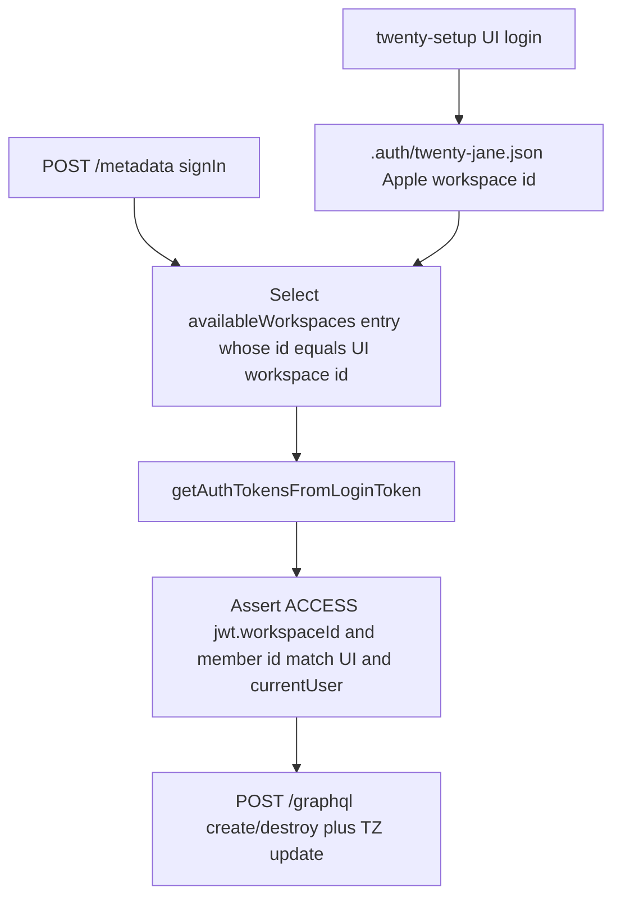

# Phase 2f task 3: Twenty QA data and session fixture

Repo `D:\Jayami\Portfolio\p1-web-e2e-ci` · [Jayami123/playwright-e2e-ci-framework](https://github.com/Jayami123/playwright-e2e-ci-framework) · P1. Branch `feat/2026-10-14-p1-phase2f-twenty-fixture` from `main` `4d22881` (PRs #25 and #26 merged; harness `#v0.2.8`). Structure/depth model: [2026-10-11-phase-2e-task3-2fa.md](2026-10-11-phase-2e-task3-2fa.md). Status: plan only; fixture not built.

Start:

```bash
git checkout main && git pull && git checkout -b feat/2026-10-14-p1-phase2f-twenty-fixture
```

"Verified live" means the 2026-10-14 planning probe against `twentycrm/twenty:v2.44.0` on `http://127.0.0.1:3002` (stack already healthy; `GET /healthz` **200**; containers `qa-harness-twenty-*` up ~54 min). No fork edits. Twenty was not started or stopped by hand.

P1-TW-TZ-001/002/003 stay tasks 4–5. This task adds no case IDs.

## Decisions (from review and probe)

- Keep **twenty-setup UI `storageState`** ([ADR 0012](../adr/0012-twenty-ui-storage-state.md)). Do not inject Bearer into the browser.
- **Do not use harness `authenticate()` as the CRM token.** Live JWT `type` is `WORKSPACE_AGNOSTIC` (no `workspaceId`). `/graphql` then has no CRM types (`Unknown type "CompanyCreateInput"`). Same `signIn` mutations as the harness, then **exchange the pinned workspace `loginToken`** so the ACCESS JWT `workspaceId` equals the UI session workspace id.
- Pin by **workspace id**, not `workspaces[0]` and not `displayName === "Apple"`. Record the 2-workspace single-workspace fallback as an observation (do not edit fork or harness seed). Guard error messages name **ids only**, never tokens.
- GraphQL client throws on `errors[]` even when HTTP is 200 **and** `data` is present. Also throw on the top-level `{ message, extensions }` shape (task 2 wrong-password).
- Record names `P1-QA-<seed>-<worker>-…` from `P1_SEED` + `workerInfo.parallelIndex` + Faker (`setFactorySeed`, same as Documenso). Teardown deletes **by captured id**. `sweep.ts` takes a **prefix argument**. Global `P1-QA-%` sweep lives only in global setup/teardown. The live idempotence test sweeps only `P1-QA-<seed>-<worker>-SweepProbe-*`.
- Member TZ helper uses `/graphql` `updateWorkspaceMember` (returns `{ id, timeZone }`). Restore original in `finally`, including when the test throws. Jane's seed value is `"system"`. TZ is workspace-global: TZ tests stay serial; `PW_WORKERS>1` isolation tests must not change TZ.
- Fixture teardown order: destroy captured records, then restore TZ, then throw `AggregateError` if anything failed. A failed destroy must still restore TZ.
- **closeDate is DATE_TIME, not DATE.** Do not invent a custom DATE field. `createdAt` is DATE_TIME. The only DATE field on this seed is `pet.birthday`. Out of scope to wrap pets. Task 4 decides the TZ-001 oracle; this task does not.
- No `test.fail` in this task. No new case IDs. No README coverage-line change.

## 1. Live probe (2026-10-14, this session)

Stack already up (`qa-harness-twenty-server-1`, image `twentycrm/twenty:v2.44.0`). Server log (from 2026-10-13 boot): `2 workspaces found in database. In single-workspace mode, there should be only one workspace. The Apple seed workspace will be used as fallback if present.` Overlay keeps `IS_MULTIWORKSPACE_ENABLED=false` ([qa-portfolio-harness/docker/twenty.compose.yml](D:/Jayami/Portfolio/qa-portfolio-harness/docker/twenty.compose.yml)).

Did not re-run `npm run test:twenty` for the probe (health already 200). Used the same `/metadata` `signIn` / `getAuthTokensFromLoginToken` mutations as harness [`twenty.adapter.ts`](D:/Jayami/Portfolio/qa-portfolio-harness/src/adapters/twenty.adapter.ts). Probe create/destroy leftovers cleaned: companies/opportunities matching `P1-QA-probe` and stray name `x` **after=0**.

### Workspaces (UI vs API)

| Surface                                             | workspace id                                                      | member id                                                               | notes                                                                                                 |
| --------------------------------------------------- | ----------------------------------------------------------------- | ----------------------------------------------------------------------- | ----------------------------------------------------------------------------------------------------- |
| UI `.auth/twenty-jane.json` `currentWorkspaceState` | `20202020-1c25-4d02-bf25-6aeccf7ea419` (Apple)                    | `currentWorkspaceMemberState.id` `20202020-463f-435b-828c-107e007a2711` | cookie `twenty-session` still httpOnly, 48 chars                                                      |
| `signIn` `/metadata`                                | Apple same id; YCombinator `3b8e6458-5fc1-4e63-8563-008ccddaa6db` | both have `loginToken`                                                  | Jane `userId` `20202020-e6b5-4680-8a32-b8209737156b`                                                  |
| harness `authenticate()` JWT                        | **null** (`type: WORKSPACE_AGNOSTIC`)                             | **null**                                                                | `currentUser.currentWorkspace` **null**                                                               |
| Apple `getAuthTokensFromLoginToken` JWT             | Apple id                                                          | Jane member id                                                          | `type: ACCESS`; `currentUser.currentWorkspace.displayName` Apple                                      |
| YCombinator exchange                                | —                                                                 | —                                                                       | HTTP **200**, `errors[]` `FORBIDDEN` / `FORBIDDEN_EXCEPTION`, `Token is not valid for this workspace` |

Fixture assert: ACCESS `workspaceId` === UI `currentWorkspaceState.id` === `currentUser.currentWorkspace.id`, and ACCESS `workspaceMemberId` === UI member id === `currentUser.workspaceMember.id`. Mismatch fails fast with those ids in the message (no token). Do not call `/graphql` CRM until JWT `type === "ACCESS"` and `workspaceId` is set.

### Mutations (exact live shapes)

Auth, **`POST /metadata`**:

```graphql
mutation SignIn($email: String!, $password: String!) {
  signIn(email: $email, password: $password) {
    tokens {
      accessOrWorkspaceAgnosticToken {
        token
        expiresAt
      }
      refreshToken {
        token
        expiresAt
      }
    }
    availableWorkspaces {
      availableWorkspacesForSignIn {
        id
        displayName
        loginToken
      }
    }
  }
}

mutation GetAuthTokensFromLoginToken($loginToken: String!, $origin: String!) {
  getAuthTokensFromLoginToken(loginToken: $loginToken, origin: $origin) {
    tokens {
      accessOrWorkspaceAgnosticToken {
        token
        expiresAt
      }
      refreshToken {
        token
        expiresAt
      }
    }
  }
}

query CurrentUser {
  currentUser {
    id
    email
    currentWorkspace {
      id
      displayName
    }
    currentUserWorkspace {
      id
      userId
    }
    workspaceMember {
      id
      timeZone
    }
  }
}

mutation UpdateWorkspaceMemberSettings($input: UpdateWorkspaceMemberSettingsInput!) {
  updateWorkspaceMemberSettings(input: $input)
}
```

`UpdateWorkspaceMemberSettingsInput` is `{ workspaceMemberId: UUID, update: JSON }`. Live `update: { timeZone: "UTC" }` returned `true`. Prefer `/graphql` update because it returns the written TZ.

CRM, **`POST /graphql`** with Apple ACCESS Bearer (not the agnostic token):

```graphql
mutation CreateCompany($input: CompanyCreateInput!) {
  createCompany(data: $input) {
    id
    name
  }
}
mutation CreatePerson($input: PersonCreateInput!) {
  createPerson(data: $input) {
    id
    name {
      firstName
      lastName
    }
  }
}
mutation CreateOpportunity($input: OpportunityCreateInput!) {
  createOpportunity(data: $input) {
    id
    name
    closeDate
    createdAt
  }
}
mutation DestroyCompany($companyId: UUID!) {
  destroyCompany(id: $companyId) {
    id
  }
}
mutation DestroyPerson($personId: UUID!) {
  destroyPerson(id: $personId) {
    id
  }
}
mutation DestroyOpportunity($opportunityId: UUID!) {
  destroyOpportunity(id: $opportunityId) {
    id
  }
}
mutation UpdateWorkspaceMember($id: UUID!, $data: WorkspaceMemberUpdateInput!) {
  updateWorkspaceMember(id: $id, data: $data) {
    id
    timeZone
  }
}
```

Live creates: company `{ name }`; person `{ name: { firstName, lastName } }`; opportunity `{ name, closeDate }` with both `"2027-01-01"` (stored `2027-01-01T00:00:00.000Z`) and `"2027-01-01T00:30:00.000Z"`. `createOneCompany` is not usable. Introspection is **disabled** on both endpoints.

Filters that worked: `companies`/`opportunities` `name: { ilike: "%P1-QA-%" }` (and `like`); `people` `name: { firstName: { ilike: "P1-QA-%" } }`; `workspaceMember(filter: { id: { eq } })`.

### Field metadata (`/metadata` `objects`, Apple ACCESS)

- opportunity `closeDate`: **DATE_TIME** (not DATE). System `createdAt` / `updatedAt` / `deletedAt`: DATE_TIME.
- person / company: no DATE field.
- workspaceMember `timeZone`: **TEXT**, seed `"system"`.
- pet `birthday`: **DATE** (Apple custom seed). Do not wrap pets in this task.

### Error shapes (all HTTP 200)

Client must throw. Do not treat HTTP 200 as success.

| Case                    | Body                                                                                                                                                        |
| ----------------------- | ----------------------------------------------------------------------------------------------------------------------------------------------------------- |
| `errors[]` + `data`     | `deleteCompany` missing id: `data.deleteCompany: null`, `errors[0].message` `Record not found`, `extensions.code` `NOT_FOUND`, `subCode` `RECORD_NOT_FOUND` |
| `errors[]` only         | missing Bearer: `Missing authentication token`, `UNAUTHENTICATED`; bad Bearer: `Token invalid.`, `UNAUTHENTICATED`                                          |
| Top-level, no `errors`  | task 2 wrong password on `/metadata`: `{ message, extensions }`                                                                                             |
| Agnostic `/graphql` CRM | `Unknown type "CompanyCreateInput"`                                                                                                                         |
| YCombinator exchange    | `Token is not valid for this workspace`, `FORBIDDEN`                                                                                                        |

Unknown selection `notARealField` did **not** produce `errors[]` (returned `null` and created a row). Do not use schema-lenient fields as an oracle.

### Token lifetime

- ACCESS and WORKSPACE_AGNOSTIC: **1800s (30m)** live (`jwt.exp - jwt.iat`, `expiresAt`). Fork default `ACCESS_TOKEN_EXPIRES_IN = '30m'`.
- Refresh `expiresAt` ~60 days. Harness `authenticate()` does not return it.
- Real expiry mid-run was **not waited out**. Forged expired JWT (invalid signature) returned `Token invalid.`, not a distinct expired code.
- Fixture mints a fresh Apple ACCESS token **per test** (30m covers one test). On `UNAUTHENTICATED`, re-exchange **exactly once** then throw. Do not share one 30m token across a long worker.

## 2. Workspace pin (chosen) and rejected alternatives



Chosen: pin target workspace **by id** from the UI session, exchange that `loginToken`, assert JWT + `currentUser` match. Fail with a message that names both **ids** if they differ. Never include a token, loginToken, or Bearer in that error.

Rejected (this task does not edit fork or harness seed):

- Rely on Apple fallback / agnostic token: **live `/graphql` cannot create records**.
- `workspaces[0]`: order coincidence; harness loginToken path already does this; P1 must not.
- `displayName === "Apple"`: name coupling.
- Enable `IS_MULTIWORKSPACE_ENABLED` or delete YCombinator: overlay/seed change, out of scope.
- Use YCombinator token: Jane exchange is FORBIDDEN in this mode.

## 3. Files

New under [`src/products/twenty/fixtures/`](../../src/products/twenty/fixtures/):

- `graphql.ts` — `twentyGraphql(path, { auth, query, variables })`. Parse body as `unknown`. Throw `TwentyGraphqlError` with HTTP status, `errors[].message` / `code` / `subCode` (no token). Throw on top-level `message` without `data`. Throw if `errors[]` is non-empty even when `data` is set. On `UNAUTHENTICATED`, the session helper re-exchanges once, retries the same operation once, then throws.
- `auth.ts` — `signInJane`, `exchangeWorkspaceAccess(loginToken)`, `loadUiWorkspaceIds(authStatePath)`, `createPinnedTwentyApiSession()`. Pin + guard. Never log tokens. Guard throw: ids only.
- `names.ts` — `p1QaPrefix(seed, worker)` → `P1-QA-<seed>-<worker>` using `String(seed)` and `String(worker)`; record names append Faker (`fakeOrg` / `fakePerson`).
- `records.ts` — `createCompany` / `createPerson` / `createOpportunity` / `destroy*` by id. Opportunity always sends `closeDate` as an ISO string (DATE_TIME). Destroy missing id throws (`RECORD_NOT_FOUND`), same as Cal teardown.
- `timezone.ts` — `readMemberTimeZone`, `setMemberTimeZone`.
- `sweep.ts` — `sweepTwentyQaRecords(prefix)` counts then destroys companies/opportunities whose `name` `ilike` `${prefix}%` and people whose `name.firstName` `ilike` `${prefix}%`. Log `Local Twenty qa-record sweep (before=${String(before)}, deleted=${String(deleted)}, after=${String(after)})`. Global setup/teardown pass `P1-QA-`. The live idempotence test passes `P1-QA-<seed>-<worker>-SweepProbe-`.
- `index.ts` — Playwright `test.extend`: worker `factorySeed` (copy Documenso); `twentyQa` fixture `{ prefix, api, workspaceId, memberId, createCompany, createPerson, createOpportunity, setTimeZone, readTimeZone }`. `finally` order: destroy captured ids, restore TZ if this test changed it, then throw `AggregateError` if any of those failed (or the test error). Destroy failure must not skip TZ restore.

Modified:

- [`src/products/twenty/env.ts`](../../src/products/twenty/env.ts) — routes `graphql: "/graphql"`, `metadata: "/metadata"`.
- [`global-setup/twenty.ts`](../../global-setup/twenty.ts) — after seed, local (non-CI) sweep with prefix `P1-QA-`, like [global-setup/documenso.ts](../../global-setup/documenso.ts).
- [`playwright.config.ts`](../../playwright.config.ts) — `globalTeardown` when `runsTwenty` (new `global-teardown/twenty.ts`, same sweep with prefix `P1-QA-`). Playwright 1.63 accepts a string; Twenty-only because teardown is gated like setup.
- [`tests/setup/twenty.setup.ts`](../../tests/setup/twenty.setup.ts) / smoke — **unchanged** session approach.

New tests:

- `tests/unit/twenty-graphql.spec.ts` — mocked `fetch`, HTTP 200 + `errors[]` throws; top-level `message` throws; HTTP 200 + `data` without errors returns data. Tags `@unit` `@twenty-fixture`.
- `tests/unit/twenty-workspace-guard.spec.ts` — mocked UI id vs JWT/`currentUser` mismatch throws; message contains ids and does not contain a token. Tags `@unit` `@twenty-fixture`.
- `tests/unit/twenty-names.spec.ts` — prefix format `P1-QA-<seed>-<worker>`; `String()` of seed and worker; worker 0 vs 1 produce different prefixes. Tags `@unit` `@twenty-fixture`.
- `tests/unit/twenty-unauthenticated-retry.spec.ts` — mocked `fetch`: first CRM call returns HTTP 200 `UNAUTHENTICATED`; helper re-exchanges once and retries; second CRM call still `UNAUTHENTICATED`; helper throws; exchange counted **exactly once**. Tags `@unit` `@twenty-fixture`.
- `tests/unit/twenty-teardown-order.spec.ts` (or live equivalent) — destroy throws; TZ restore still ran; `AggregateError` surfaces both. Tags `@unit` `@twenty-fixture` if mocked; `@twenty` `@twenty-fixture` if live.
- `tests/twenty/fixture/self.spec.ts` — live, tags `@twenty` `@twenty-fixture`, **no P1-TW-TZ ids**.

Lint: `String()` in templates; no unchecked `[0]` (narrow the pinned workspace or throw). No new dependency. No secrets in logs.

Small ADR `docs/adr/0013-twenty-qa-api-fixture.md`: pin-by-id, agnostic token rejected with probe evidence, closeDate DATE_TIME observation (undecided for TZ-001), TZ restore, prefix-scoped sweep. Needed so tasks 4–5 do not rediscover this.

## 4. Fixture `twentyQa`

Depends on existing `storageState` (page). Own `APIRequestContext` is optional; `fetch` via the graphql helper is enough (no cookies on API).

1. Worker `factorySeed`: `P1_SEED` + `parallelIndex`, `setFactorySeed`, log `P1_SEED=… worker=… seed=…` with `String()`.
2. Read UI workspace/member ids from `loadTwentyConfig().authStatePath` localStorage (`currentWorkspaceState.id`, `currentWorkspaceMemberState.id`). Missing keys throw.
3. `signIn` + pin that workspace id + exchange + `currentUser` guard.
4. `use({ prefix, create*, setTimeZone, … })`.
5. `finally`: destroy captured ids, then restore TZ if changed, then throw `AggregateError` if the test or teardown failed.

`setTimeZone` reads original once, sets, registers restore. Nested calls not required (YAGNI).

## 5. Tests (no product case IDs)

| Test                                              | Where                  | What                                                                                                                                                                                                                                                      |
| ------------------------------------------------- | ---------------------- | --------------------------------------------------------------------------------------------------------------------------------------------------------------------------------------------------------------------------------------------------------- |
| GraphQL `errors[]` HTTP 200 throws readable error | `tests/unit`           | Mock body like live RECORD_NOT_FOUND and UNAUTHENTICATED                                                                                                                                                                                                  |
| Top-level `{ message, extensions }` throws        | `tests/unit`           | Task 2 wrong-password shape                                                                                                                                                                                                                               |
| Wrong-workspace guard                             | `tests/unit`           | Mock UI Apple id vs JWT some other id; error lists ids, no token                                                                                                                                                                                          |
| Prefix format                                     | `tests/unit`           | `P1-QA-<seed>-<worker>`; `String(seed)` / `String(worker)`; worker 0 ≠ worker 1                                                                                                                                                                           |
| UNAUTHENTICATED re-exchange                       | `tests/unit`           | Mock fetch; re-exchange exactly once then throw                                                                                                                                                                                                           |
| Failed destroy still restores TZ                  | `tests/unit` or live   | Destroy throws; TZ still restored; AggregateError                                                                                                                                                                                                         |
| TZ restore after inner throw                      | live `@twenty-fixture` | `setTimeZone("UTC")`, **read back `"UTC"`**, then throw inside helper, then assert TZ is back to original (`"system"` on this seed). A no-op `setTimeZone` must fail this test. Serial. Does not run under the isolation worker pair as a TZ mutator.     |
| Parallel isolation                                | live `@twenty-fixture` | Each worker creates `P1-QA-<seed>-<worker>-SameLeaf`. Neither finds or destroys the other's row. **Only proven with `PW_WORKERS=2`.** A one-worker run of this test does not count as isolation evidence.                                                 |
| Sweep idempotence                                 | live `@twenty-fixture` | Create one record named `P1-QA-<seed>-<worker>-SweepProbe-…`. Call `sweepTwentyQaRecords` with **that** prefix (not `P1-QA-%`). First sweep: deleted>=1, after=0. Second sweep: before=0, deleted=0, after=0. Must not delete another worker's live rows. |
| Smoke unchanged                                   | existing               | Still no CRM mutations in smoke                                                                                                                                                                                                                           |

Do not weaken oracles. Label any unexpected failure PRODUCT BUG vs TEST BUG with HTTP body (redacted) before changing code.

## 6. Risks

- Shared Jane TZ races if `PW_WORKERS>1` on TZ tests. Keep TZ tests serial; the isolation run (`PW_WORKERS=2 --grep @twenty-fixture`) must not include a TZ mutation, or the TZ test must skip when `parallelIndex` is in a multi-worker run. Prefer: isolation spec in its own file grepped with the rest of `@twenty-fixture` only if TZ restore is also safe (serial describe + no TZ change in isolation). Isolation spec creates records only.
- 30m ACCESS token: per-test mint. If a single test exceeds 30m, that is an environment failure, not a retry loop.
- Real expiry message not observed; treat `UNAUTHENTICATED` as re-auth once, then throw.
- `closeDate` DATE vs P1-TW-TZ-001: product schema is DATE_TIME. Do not invent DATE. Do not decide the oracle here.
- Global sweep `ilike P1-QA-%` could theoretically match a seed name. Seed companies are not `P1-QA-*` (probe filter empty after cleanup). If a destroy hits 0 for a captured id, throw.
- A test that swept `P1-QA-%` under `PW_WORKERS=2` would delete the other worker's rows. That is why idempotence uses `SweepProbe-` and global sweep stays in setup/teardown.
- Never `git add -A`. Stage explicit paths.
- Twenty not in CI yet (known gap). Local gate only.

## 7. Commands (Windows; one Playwright run at a time)

1. `git checkout main && git pull && git checkout -b feat/2026-10-14-p1-phase2f-twenty-fixture`
2. This plan file is already the first commit material. Do not fold unrelated working-tree dirt.
3. Build: `env.ts` routes → `graphql.ts` + unit → `auth.ts` + workspace-guard unit → `names` + names unit → UNAUTHENTICATED retry unit → `records`/`timezone`/`sweep` → fixture `index.ts` + teardown-order test → global setup/teardown → live `self.spec.ts` → ADR 0013.
4. `npm run check`
5. `npm run test:unit`
6. Required live gate (paste every summary):
   - `PW_WORKERS=2 npx playwright test --project=twenty-chromium --grep @twenty-fixture` (isolation proof; required, not extra)
   - `npm run test:twenty` twice. Sweep log `after=0` both times.
7. Commit `feat(twenty): add QA API fixture and P1-QA sweep` with explicit paths. `git push -u origin HEAD`. No PR (Jayami opens it). No merge, no tag.

## 8. Final report must include

- Probe: workspace ids (UI vs agnostic vs Apple ACCESS), YCombinator FORBIDDEN exchange, mutation names, closeDate DATE_TIME, pet.birthday DATE, error shapes, token TTL 1800s, what was not verified (real 30m expiry wait; `test:twenty` not re-run during planning).
- `npm run check` and `npm run test:unit` results.
- The **`PW_WORKERS=2 --grep @twenty-fixture`** summary (isolation).
- Both `npm run test:twenty` summaries and sweep `before=`/`deleted=`/`after=` lines (`after=0`).
- That twenty-setup still UI-logs in every run (ADR 0012 unchanged).
- Open question for task 4: TZ-001 DATE oracle vs live DATE_TIME `closeDate`. Do not decide it in this task.
