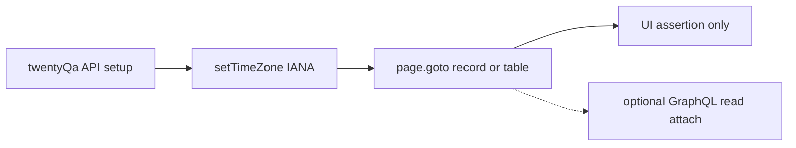

# Phase 2f task 4: Twenty timezone UI E2E

Repo `D:\Jayami\Portfolio\p1-web-e2e-ci` · [Jayami123/playwright-e2e-ci-framework](https://github.com/Jayami123/playwright-e2e-ci-framework) · P1. Branch `feat/2026-10-15-p1-phase2f-twenty-tz` from `main` `79e5357` (PR #27 merged). Working tree clean at planning. Harness `#v0.2.8`, image `twentycrm/twenty:v2.44.0` already healthy on `http://127.0.0.1:3002` (`GET /healthz` **200**, containers up ~3h). Never edit the Twenty fork. Never start/stop Twenty by hand.

Structure/depth model: [2026-10-11-phase-2e-task3-2fa.md](2026-10-11-phase-2e-task3-2fa.md).

**Standing rule:** this is UI E2E. `twentyQa` may create records and set member TZ through GraphQL for speed. The behaviour under test and **every assertion** go through the Twenty UI, which is the source of truth. An API-only assertion is never acceptable. API reads may be attached as supporting evidence only (redacted, no tokens).

"Verified live" means the 2026-10-15 planning probe in Cursor's browser against the running stack (Jane UI login). "Verified in source" means read from `products/twenty-CRM` (fork describe is 2.43+; runtime is v2.44.0). "Not verified live" must be confirmed in implementation step 0 before it becomes an assertion.

TZ-003 (Berlin DST group-by-day) stays **OPEN for task 5**. Do not build it.

Do not push. Jayami runs `cr review --agent` and sends fixes before the push.

---

## Decisions (from review)

- **Step 0 checkpoint.** After the write-probes, stop. Report open questions 1-5 with evidence (screenshots, request bodies, exact UI strings) before writing `tz.spec.ts`. If question 1 is "stuck on system", stop and report. Do not work around it (no localStorage patch, no Settings visit as a substitute for API TZ, no extra reload loop).
- **TZ abbrev oracle.** E2E expected short TZ name comes from the **browser**: `page.evaluate` of `Intl.DateTimeFormat("en", { timeZone, timeZoneName: "short" })`. Node `Intl` is only for unit tests of `display.ts` (civil date/time strings, not the live abbrev). Never drop the abbrev from the E2E match.
- **X02 restore.** X02 changes TZ through the Settings UI. The fixture must still restore the TZ captured **before** the test. X02 runs **last** in the serial describe. Prove restore with an assertion on that path.
- **OBS-001 labels are hypotheses until intent is cited.** Before EXPECTED or PRODUCT BUG, cite what Twenty intends (DATE_TIME picker / `getDateTimeMask` behaviour for a date-only entry, or docs). If intent cannot be shown, label OBSERVATION with evidence and no `test.fail()`.
- **Serial safety.** List every spec that writes Jane's TZ. No other spec in the `@twenty` run may write it. `PW_WORKERS=2 npm run test:twenty` must be green (full suite, not only `@twenty-tz`).
- **DATE/DATE_TIME negatives.** TZ-001: `"Dec 31, 2026"` is **not** present in the row or Fields widget on either surface. TZ-002 UTC: `"6:00 AM"` is **not** present in the row or Fields widget.
- **Sweep pets.** Unit-test pets list/destroy (reuse pagination). Sweep log `before` / `deleted` / `after` include pets.
- **Git.** Report every verification summary, then commit with explicit paths. Do not push.

---

## Standing isolation choice (Jane TZ)

Jane is one workspace member. Member TZ is per member, not per worker. **TZ-mutating product cases stay in one serial describe** in `tests/twenty/tz/tz.spec.ts`, with **X02 last**. `PW_WORKERS=2` is safe only if **no other file** in the twenty-chromium run writes Jane's TZ while that describe runs.

Rejected: per-worker members (Tim/Jony). Extra `storageState` logins. ADR 0013 already chose serial TZ mutation.

### Specs that write Jane's TZ (must stay true)

| Spec                                                                                                                | Writes TZ?                                 | How                                      | `PW_WORKERS=2`        |
| ------------------------------------------------------------------------------------------------------------------- | ------------------------------------------ | ---------------------------------------- | --------------------- |
| [tests/twenty/smoke/home.spec.ts](../../tests/twenty/smoke/home.spec.ts)                                            | No                                         | UI read only                             | Runs on either worker |
| [tests/twenty/fixture/self.spec.ts](../../tests/twenty/fixture/self.spec.ts) isolation + sweep                      | No                                         | Creates companies only                   | Parallel OK           |
| [tests/twenty/fixture/self.spec.ts](../../tests/twenty/fixture/self.spec.ts) `restores member TZ after inner throw` | **Yes** (`setTimeZone`)                    | Already `test.skip()` when `workers > 1` | Skipped               |
| [tests/twenty/tz/tz.spec.ts](../../tests/twenty/tz/tz.spec.ts) (this task)                                          | **Yes** (`setTimeZone` and/or Settings UI) | Serial describe                          | One worker            |
| Unit specs under `tests/unit/twenty-*.spec.ts`                                                                      | No                                         | No live Jane                             | `test:unit` project   |

Implementation evidence: `rg setTimeZone tests src/products/twenty` in the task report. If a new caller appears, stop. Do not add TZ writes to smoke or isolation.

Under `PW_WORKERS=2`, the fixture TZ-restore test stays skipped, so the only live writer is `tz.spec.ts` on one worker. That is the condition `npm run test:twenty` with two workers relies on.

---

## 1. Live probe findings (2026-10-15)

Stack: `qa-harness-twenty-server-1` `twentycrm/twenty:v2.44.0` healthy. Logged in as Jane (`jane.austen@apple.dev`) through `/welcome`. Did not change Jane's TZ. Did not create records. Close-date **entry request was not captured** (picker click did not open edit mode from a JS click; Playwright locator click is the implementation probe).

### Pets (DATE field): used, no custom DATE fallback

| Fact            | Live                                                                                                     |
| --------------- | -------------------------------------------------------------------------------------------------------- |
| Nav             | `getByRole("link", { name: "Pets" })` → `/objects/pets?viewId=71d84502-e954-4aec-a125-74d4c9900172`      |
| List            | title `All Pets - Pets`; `All Pets · 1`; `Create Pet`                                                    |
| Seed row        | `data-testid="row-id-20202020-0f2a-49d8-8aa2-ec8786153a0b"`; name link `Toby` → `/object/pet/<id>`       |
| Birthday column | header `getByRole("button", { name: "Birthday" })` (two copies: header + options; **do not `.first()`**) |
| Birthday cell   | `editable-cell-display-mode` text **`Jan 1, 2019`** (no time)                                            |
| Record page     | title `Toby - Pet`; Fields widget `data-testid="record-fields-widget"`; **Birthday / Jan 1, 2019**       |

Source (dev seeder, not a standard object): `pet.birthday` is `FieldMetadataType.DATE`. Fallback custom DATE field is **not needed**.

### Why TZ-001 moved off `closeDate`

ADR 0013 + live metadata: `opportunity.closeDate` is **DATE_TIME** (`timestamptz`). A DATE no-shift case on `closeDate` would be a false oracle (Honolulu vs Kiritimati **should** shift a DATE_TIME). `pet.birthday` is the seeded DATE field. That is the TZ-001 target.

### Member TZ in the UI

| Fact              | Live                                                                                                                                     |
| ----------------- | ---------------------------------------------------------------------------------------------------------------------------------------- |
| Path              | `/settings/experience` (sidebar **Experience**, not Profile)                                                                             |
| Control           | Formats → Time zone. Current Jane: button name `System settings · (GMT+05:30) India Standard Time - Colombo`                             |
| Also on that page | Date format `System settings · Mar 12, 2024`; Time format `System settings · 3:00 PM`                                                    |
| Dropdown          | Search (`aria-label="Search"`). Options include Honolulu and Kiritimati. UTC label not confirmed in the visible slice (open question 4). |
| Jane localStorage | `timeZone: "system"`, `dateFormat: "SYSTEM"`, `timeFormat: "SYSTEM"`, `locale: "en"`, `openRecordIn: "SIDE_PANEL"`                       |

Source: Settings writes jotai `workspaceMemberFormatPreferencesState` **then** `updateWorkspaceMemberSettings`. Display that reads `UserContext` updates **without a full reload** when TZ is changed **in the UI**. Fixture `setTimeZone` is GraphQL-only, so tests must `page.goto` (full navigation) after the mutation so `currentUser` / member state refetches.

**Question 1 is a hard stop.** If after `setTimeZone("UTC")` + `page.goto` the UI still renders as `"system"` (host Colombo), stop and report. Do not work around it.

Host TZ on this machine is Colombo, so Jane `"system"` DATE_TIME already looks like Colombo. Tests must set an IANA member TZ. Do not leave `"system"`.

### DATE vs DATE_TIME render (exact live text)

Jane SYSTEM + Chromium `en-US` → Twenty `MONTH_FIRST` (`MMM d, yyyy`) + 12-hour (`h:mm aa`). Master-plan prose "1 Jan 2027" is UK order; **live is US order**. Oracle follows live format, not the prose glyph order. The calendar day is still 1 Jan 2027.

| Surface                    | DATE (birthday) | DATE_TIME (closeDate)                                                                        |
| -------------------------- | --------------- | -------------------------------------------------------------------------------------------- |
| Table                      | `Jan 1, 2019`   | `Jan 5, 2027 1:47 AM`                                                                        |
| Record Fields              | `Jan 1, 2019`   | `Jan 5, 2027 1:47 AM`                                                                        |
| TZ abbrev (Jane system)    | none            | empty `<span>` (source: `TimeZoneAbbreviation` hides when `isSystemTimezone`)                |
| TZ abbrev (IANA member TZ) | none            | shown, `Intl` `timeZoneName: "short"` (source; not seen live because Jane stayed `"system"`) |
| Creation date on record    | n/a             | **relative** (`about 22 hours ago`): do not use as the DATE_TIME oracle                      |

Table is CSS/div, not `role="table"`. Row `data-testid="row-id-${id}"`. Record Fields widget `data-testid="record-fields-widget"`. Field labels are tooltip text (`Birthday`, `Close date`), no `aria-label` on the value. A11y finding (observation only, not `test.fail`): inline date values have no accessible name.

Mailbox banner `Reconnect` / `Close banner` is present. Scope locators to the row / Fields widget. If it intercepts a click, close it with `getByRole("button", { name: "Close banner" })`.

### closeDate entry (source + partial live)

Live: display confirmed; **picker did not open** in this probe. Source:

- Calendar + masked header input (`DateTimePicker` / `DateTimePickerInput`, `react-imask`, mask from `getDateTimeMask`)
- Persist: `Temporal.Instant.toString()` ISO
- Mutation: `UpdateOneOpportunity` → `updateOpportunity(id, data: { closeDate })`
- DATE entry emits `YYYY-MM-DD`; DATE_TIME expects `'YYYY-MM-DDTHH:mm:ssZ'`

OBS-001 classification waits on the step 0 write-probe **and** a source citation of intent (section 6).



---

## 2. Step 0 checkpoint (hard stop)

Throwaway prefix `P1-QA-probe-`. Destroy every created row. Sweep `after=0` including pets. Then **stop**. Do not write `tz.spec.ts` until the report below is in chat.

Probes:

1. **API TZ + UI refetch (Q1).** `setTimeZone("UTC")`, `page.goto` a QA opportunity record (known `closeDate` ISO). Screenshot + exact Fields text. Compare with the `"system"` / Colombo rendering of the same ISO. If the UI did not move off Colombo/system, **stop**. Do not patch localStorage, do not add `page.reload` loops, do not switch the case to Settings-only as a workaround.
2. **`createPet` shape (Q2).** GraphQL `createPet` with `{ name, birthday: "2027-01-01" }`. Record the success payload or `errors[]`. Destroy by id.
3. **closeDate UI entry (Q3).** Honolulu member, QA opportunity, open Close date **through the UI**, enter a bare date. `waitForResponse` on `updateOpportunity`. Attach: screenshot, exact Fields text, request `closeDate`, stored `closeDate` (evidence only). Destroy the row. Restore TZ.
4. **UTC option label (Q4).** Settings → Experience → Time zone Search. Exact accessible/visible string for UTC. Do not select it if that would leave Jane off `"system"`; if a select is needed, restore immediately.
5. **Chromium short names (Q5).** `page.evaluate` `Intl.DateTimeFormat("en", { timeZoneName: "short", timeZone })` for `Asia/Colombo`, `Pacific/Honolulu`, `UTC` at `2027-01-01T00:30:00.000Z`. Record the three strings.

Checkpoint report must answer Q1-Q5 with that evidence before any `tz.spec.ts` line is written.

---

## 3. Files

New:

- [src/products/twenty/timezones.ts](../../src/products/twenty/timezones.ts): `HONOLULU_TZ`, `KIRITIMATI_TZ`, `COLOMBO_TZ`, `UTC_TZ`. Do not import Cal's timezone module.
- [src/products/twenty/display.ts](../../src/products/twenty/display.ts): civil oracles (`formatTwentyDate`, `formatTwentyDateTime`) via `Intl`, matching live MONTH_FIRST + 12-hour. DATE uses a UTC-noon instant so the calendar day cannot shift. **No TZ abbrev in these helpers.** Unit-tested in Node. E2E appends the browser abbrev (section 6).
- [src/products/twenty/pages/object-table.page.ts](../../src/products/twenty/pages/object-table.page.ts): list for pets or opportunities: nav link, `goto` index route, row by id, name link, cell text. No business assertions.
- [src/products/twenty/pages/record.page.ts](../../src/products/twenty/pages/record.page.ts): `goto` `/object/{pet|opportunity}/:id` (full page, not side panel). Fields widget. Date value by visible text. Open closeDate editor + type/submit for OBS-001 only after step 0 confirms locators.
- [src/products/twenty/pages/settings-experience.page.ts](../../src/products/twenty/pages/settings-experience.page.ts): `/settings/experience`, Time zone search + option. Required for X02.
- [tests/twenty/tz/tz.spec.ts](../../tests/twenty/tz/tz.spec.ts): mapped cases + kept extras. Tags `["@twenty", "@twenty-tz"]`. Serial describe, **X02 last**. `test.use({ locale: "en-US" })`. Written **after** the step 0 checkpoint.
- [tests/unit/twenty-display.spec.ts](../../tests/unit/twenty-display.spec.ts): DATE no-shift across Honolulu/Kiritimati civil strings; DATE_TIME Colombo `6:00 AM` / UTC `12:30 AM` for `2027-01-01T00:30:00.000Z`; `String()` in templates. Abbrev not asserted here.
- [docs/adr/0014-twenty-timezone-testing.md](../adr/0014-twenty-timezone-testing.md): probe facts, DATE vs DATE_TIME, serial Jane, browser abbrev, OBS-001 classification, TZ-writer list.

Modified:

- [src/products/twenty/env.ts](../../src/products/twenty/env.ts): routes `pets`, `petRecord`, `opportunities`, `opportunityRecord`, `settingsExperience`.
- [src/products/twenty/pages/home.page.ts](../../src/products/twenty/pages/home.page.ts): add `petsLink` (`getByRole("link", { name: "Pets" })`) and `opportunitiesLink`.
- [src/products/twenty/fixtures/names.ts](../../src/products/twenty/fixtures/names.ts): `p1QaPetName`.
- [src/products/twenty/fixtures/records.ts](../../src/products/twenty/fixtures/records.ts): `createPet` / `destroyPet`; optional `readOpportunityCloseDate` for evidence only.
- [src/products/twenty/fixtures/sweep.ts](../../src/products/twenty/fixtures/sweep.ts): list/destroy pets by `name ilike prefix%`. `countQaRecords` / `destroyListed` include pets. Log names pets (section 9).
- [src/products/twenty/fixtures/index.ts](../../src/products/twenty/fixtures/index.ts): `createPet`, `petIds` in captured set, destroy pets before TZ restore. Expose a baseline capture so X02 UI TZ changes still restore (section 7).
- [tests/unit/twenty-sweep-pagination.spec.ts](../../tests/unit/twenty-sweep-pagination.spec.ts): pets list/destroy pagination, same cursor rules as companies.
- [README.md](../../README.md): coverage line: TZ-001, TZ-002, OBS-001 (if a test exists), X01, X02; Twenty still not in CI.

Not in this task: Twenty CI job (next task), TZ-003, fork edits, `test.fail` unless intent is cited **and** a write-probe proves a product bug. No push.

---

## 4. Fixture extensions (YAGNI)

`createPet(leaf, birthday = "2027-01-01")` returns `{ id, name, birthday }`. Name `P1-QA-<seed>-<worker>-…`. Birthday sent as `YYYY-MM-DD`. Destroy by captured id.

Confirm `createPet` / `PetCreateInput` shape in step 0 (likely `{ name, birthday }`; not Person `FullName`). If create fails, stop and record the GraphQL `errors[]`. Do not invent a metadata custom field unless Pets create is impossible.

Existing `createOpportunity(leaf, closeDateIso)` already sends DATE_TIME ISO. Use `2027-01-01T00:30:00.000Z` for TZ-002 / X01 / X02.

`setTimeZone` still captures `originalTimeZone` once and restores in `finally`. X02 may never call `setTimeZone` if it only uses Settings, so the fixture would skip restore. **X02 must register the baseline before the UI change.** Smallest API: `rememberTimeZone()` (or `setTimeZone` of the current value) that calls existing `ensureTimeZoneBaseline` and registers `restoreTimeZone` without requiring a different IANA write. Do not skip fixture restore because the write went through the UI.

Do not also pin `dateFormat` unless SYSTEM+en-US display drifts in the first run. Pin Playwright `locale: "en-US"` instead.

Sweep must include pets. Global `P1-QA-` sweep in setup/teardown then reports `after=0` for companies + opportunities + people + **pets**.

---

## 5. Locators (semantic; confirmed live except picker)

| Action                   | Locator                                                                                                                                             |
| ------------------------ | --------------------------------------------------------------------------------------------------------------------------------------------------- |
| Pets / Opportunities nav | `getByRole("link", { name: "Pets" \| "Opportunities" })`                                                                                            |
| Row                      | `getByTestId("row-id-" + id)`: no `role="table"`; ADR records this like Cal testids                                                                 |
| Name in table            | row `getByRole("link", { name: exactQaName })`                                                                                                      |
| Date in table            | row `getByText(expected, { exact: true })`                                                                                                          |
| Record page              | `page.goto("/object/pet/" + id)` or `"/object/opportunity/" + id` (full page; Jane `openRecordIn` is side panel, so **do not click the table row**) |
| Date on record           | `getByTestId("record-fields-widget").getByText(expected, { exact: true })` plus the label text `Birthday` / `Close date`                            |
| Experience               | `goto /settings/experience`; Time zone option via Search then `getByText` exact option label from step 0                                            |
| Picker (OBS-001)         | **not confirmed live**: confirm `inline-cell-edit-mode-container`, masked textbox, calendar. No `.first()`, no CSS, no `waitForTimeout`.            |

---

## 6. Oracles

Independent of the product. Civil date/time strings: `display.ts` + Node unit tests. **E2E TZ abbrev: browser only.**

```ts
async function shortTimeZoneName(page: Page, timeZone: string, iso: string): Promise<string> {
  return page.evaluate(
    ({ timeZone: tz, iso: instant }) => {
      const parts = new Intl.DateTimeFormat("en", {
        timeZone: tz,
        timeZoneName: "short",
      }).formatToParts(new Date(instant));
      const name = parts.find((part) => part.type === "timeZoneName");
      if (name === undefined || name.value.trim() === "") {
        throw new Error(`browser Intl omitted timeZoneName for ${tz}`);
      }
      return name.value;
    },
    { timeZone, iso },
  );
}
```

DATE_TIME expected UI text is `${formatTwentyDateTime(iso, tz)} ${abbrev}` (spacing as live HTML). Never omit `abbrev`. Never compute abbrev in Node for an E2E assertion. `abbrev` visibility follows Twenty `TimeZoneAbbreviation` (member TZ vs browser host TZ from `Intl.DateTimeFormat().resolvedOptions().timeZone`). `@twenty-tz` pins `test.use({ timezoneId: "America/Sao_Paulo" })` so every member zone under test differs from host and abbrev is always asserted.

DATE `2027-01-01` (any member TZ): **`Jan 1, 2027`**. Same string in Honolulu and Kiritimati.

DATE_TIME `2027-01-01T00:30:00.000Z` (date **and** time **and** abbrev):

| Member TZ                | Civil            | Civil UI (en-US 12-hour)                |
| ------------------------ | ---------------- | --------------------------------------- |
| `Asia/Colombo`           | 2027-01-01 06:00 | `Jan 1, 2027 6:00 AM` + browser abbrev  |
| `UTC`                    | 2027-01-01 00:30 | `Jan 1, 2027 12:30 AM` + browser abbrev |
| `Pacific/Honolulu` (X01) | 2026-12-31 14:30 | `Dec 31, 2026 2:30 PM` + browser abbrev |

Mapped-case "06:00" / "00:30" is the civil time; live UI is 12-hour. Do not assert 24-hour unless we pin `timeFormat` (we will not, unless SYSTEM 12-hour fails).

### Negatives (required)

Scoped to the **same** row (`row-id-${id}`) or Fields widget, not the whole page (seed rows and the mailbox banner must not satisfy these).

- TZ-001, both surfaces, both TZs: `getByText("Dec 31, 2026")` is not visible in that scope.
- TZ-002 UTC, both surfaces: `getByText("6:00 AM")` is not visible in that scope (Colombo leftover).

---

## 7. Cases

`test.describe.configure({ mode: "serial" })`. Fixture `twentyQa`. Tags `@twenty` `@twenty-tz`. Annotations `testId` + `priority`. `test.step` per user-visible step. Setup (create + TZ + goto) asserted **before** any `test.fail`. **X02 is the last test in the describe.**

### P1-TW-TZ-001 DATE no-shift (P0)

1. `createPet` with `birthday: "2027-01-01"`.
2. `setTimeZone("Pacific/Honolulu")`, `page.goto` pet record **and** pets table row.
3. UI shows `Jan 1, 2027` on both surfaces (not a time). **Negative:** `"Dec 31, 2026"` absent in row and Fields widget.
4. `setTimeZone("Pacific/Kiritimati")`, `page.goto` again (full navigation so member TZ refetches).
5. UI still shows `Jan 1, 2027` on both surfaces. Same negative.

API birthday read may be attached as evidence only.

### P1-TW-TZ-002 DATE_TIME member TZ (P0)

Two `test()`s in the serial describe (Colombo / UTC) so one failure does not mask the other. Same ISO, different TZ.

1. `createOpportunity` with `closeDate: "2027-01-01T00:30:00.000Z"`.
2. Colombo: goto record **and** table. UI matches Colombo civil + **browser** abbrev.
3. UTC: goto again. UI matches UTC civil + browser abbrev. **Negative:** `"6:00 AM"` absent in row and Fields widget.

### P1-TW-TZ-OBS-001 UI bare date on DATE_TIME (P1, observation)

Not written until the step 0 checkpoint. Probe procedure is in section 2.

Classification. The bullets below are **hypotheses**, not verdicts. Before EXPECTED or PRODUCT BUG, cite Twenty's intended behaviour from source (DATE_TIME picker, `getDateTimeMask`, parse path for a date-only string) or docs. If that intent cannot be shown, the label is **OBSERVATION**: attach evidence, record it in ADR 0014, **no test**, **no `test.fail()`**.

Hypotheses (only used if intent is cited):

- **EXPECTED:** stored instant is Honolulu midnight of the entered civil date (for 1 Jan: `2027-01-01T10:00:00.000Z`) **and** the UI still shows 1 Jan in Honolulu, matching that cited intent.
- **PRODUCT BUG:** cited intent says the civil date must hold, and the UI shows 31 Dec (or another day) after the user entered 1 Jan, or stored UTC midnight `T00:00:00.000Z` that then renders as 31 Dec in Honolulu. Then keep a strict UI assertion, `test.fail()` **after** setup, `issue` `P7-OBS-TW-TZ-001`, `attachKnownBugEvidence`.
- **OBSERVATION:** default when intent is missing or the evidence does not meet a cited intent.

Do not write a passing test that copies whatever the app showed.

### P1-TW-TZ-X01 DATE_TIME across the UTC day line (keep)

Honolulu member, same ISO as 002. UI `Dec 31, 2026 2:30 PM` + browser abbrev on table and record. Distinct from 002 (which stays on 1 Jan).

### P1-TW-TZ-X02 re-render after Settings TZ change (keep, last)

1. Create opportunity with the TZ-002 ISO. `rememberTimeZone()` (or equivalent) so fixture restore is registered **before** any UI write. Read `original` via `readTimeZone()`.
2. Settings → Experience: set member TZ to Colombo (exact option label from Q4/step 0). Do not use `setTimeZone` for this change.
3. `page.goto` the **same** record (no edit of `closeDate`). Fields match Colombo oracle + browser abbrev.
4. Settings: set TZ to UTC. Goto record again. Fields match UTC oracle. Negative: `"6:00 AM"` absent.
5. **Restore proof (in this test, before it ends):** `restoreTimeZoneIfNeeded()`, then `expect(await twentyQa.readTimeZone()).toBe(original)`. Fixture `finally` still restores again. A unit test of `rememberTimeZone` + restore is acceptable **in addition**, not instead of this live assertion.

If Settings search cannot select UTC (Q4), stop and report. Do not silently fall back to API `setTimeZone` for the behaviour under test.

### Not built

P1-TW-TZ-003 Berlin DST group-by-day: task 5. X03 ("Is today" filter) and X04 (CSV) deferred.

---

## 8. Extras (required table)

| ID               | Case                                                                                        | Risk                                                     | Oracle                                              | UI assertion                                  | Cost                                    | Keep?                       |
| ---------------- | ------------------------------------------------------------------------------------------- | -------------------------------------------------------- | --------------------------------------------------- | --------------------------------------------- | --------------------------------------- | --------------------------- |
| **P1-TW-TZ-X01** | DATE_TIME `2027-01-01T00:30:00Z` as Honolulu member (UTC-10)                                | High: civil date crosses the UTC day line                | Intl civil + browser abbrev: `Dec 31, 2026 2:30 PM` | Table + record Close date text                | Low (same POMs as 002)                  | **Keep**                    |
| **P1-TW-TZ-X02** | Record exists, then member TZ changes in Settings, UI re-renders without editing the record | Medium: stale jotai; restore must still run              | Same ISO, Colombo then UTC, browser abbrev          | Record Fields after Settings TZ change        | Medium (Experience POM + restore proof) | **Keep** (last in describe) |
| P1-TW-TZ-X03     | "Is today" / relative filter across zones                                                   | High: two `Filter` buttons (nth banned); TZ-003-adjacent | Filter membership for a known instant               | Filtered table contains / excludes the QA row | High                                    | Defer                       |
| P1-TW-TZ-X04     | CSV export vs UI display                                                                    | Medium: export is ISO, UI is zoned                       | File DATE_TIME is UTC ISO; UI is zoned              | Download + Fields text                        | High                                    | Defer                       |

---

## 9. Sweep pets

[sweep.ts](../../src/products/twenty/fixtures/sweep.ts) today lists companies, opportunities, and people only. Add pets (`name ilike prefix%`), destroy by id, include them in `countQaRecords` and `destroyListed`.

Log must show pets in the counts, for example:

```
Local Twenty qa-record sweep (before=${String(before)}, deleted=${String(deleted)}, after=${String(after)}, pets=${String(pets)})
```

`before` / `deleted` / `after` are totals **including** pets. `pets=` is the pet-only count at `before` (or deleted pets). Gate: `after=0`.

Unit test in [tests/unit/twenty-sweep-pagination.spec.ts](../../tests/unit/twenty-sweep-pagination.spec.ts): two-page pets list, cursor advances, then destroy each listed id. Reuse `paginateConnectionIds`. Same failure if `endCursor` does not advance. Export a pets list/destroy helper like `destroyListedCompanies` if that is the smallest way to test it.

---

## 10. PRODUCT BUG vs TEST BUG

Label before changing a test. Evidence: screenshot + `waitForResponse` body (no token) + UI text.

- `test.fail()` only for a **proven** product bug with **cited intent**, unconditionally, **after** setup assertions, with `issue` annotation and `attachKnownBugEvidence`.
- Never weaken match, skip, retry, or extend timeout to go green.
- Unsure: ADR + task report **not verified**. Ask. Do not pick the green label.
- Q1 "stuck on system": stop. That is not a licence to work around.

---

## 11. Isolation, cleanup, lint

- Names: `P1-QA-<seed>-<worker>-…`. Unique under `PW_WORKERS=2`.
- Teardown: destroy captured pets/companies/people/opportunities by id, then restore Jane TZ (existing `finally`). X02 UI writes still restore (section 7).
- Sweep: include pets. Gate: teardown log `after=0`.
- Serial TZ file; fixture TZ-restore already skips extra workers. Full `test:twenty` with two workers must stay green.
- Lint: `String()` in templates; no unchecked `[0]`; no `await` on non-thenables; no confusing void. Unit tests for `display.ts` and pets sweep pagination.
- Locators: role/label first; testid only for `row-id-*` and `record-fields-widget`. No CSS, XPath, `.first()`, sleeps, conditional `isVisible`.

---

## 12. Risks

- **Stale member TZ in UI after API `setTimeZone`.** Hard stop at the checkpoint if Q1 fails. Do not write localStorage.
- **X02 UI TZ vs fixture restore.** Baseline must be captured before Settings writes. Prove it in X02.
- **Browser vs Node Intl abbrev.** E2E uses `page.evaluate` only. Unit tests do not assert Chromium abbrev.
- **Pets create shape unknown until step 0.** Stop if `createPet` errors.
- **Side panel vs full page.** Always `goto` record URL.
- **Mailbox banner** intercepting clicks.
- **ACCESS 1800s.** Fresh token per `twentyQa` test. One test must stay well under 30m.
- **Seed Toby / seed opportunities** must not be used as oracles (host-TZ `"system"`).
- Never `git add -A` (reports, `.auth`).

---

## 13. Twenty CI (next task: not in scope)

Note only: CI image must be the same `v2.44.0` Apple **dev seed** (Pets object present). Sweep must include pets. `@twenty-tz` is serial on Jane. CI `PW_WORKERS` must not run two TZ-mutating files. `storageState` path and ACCESS pin unchanged. Mailbox banner may differ. Firefox project not required here.

---

## 14. Commands (Windows; Git Bash; one Playwright run at a time)

1. `git status --short` and `git log --oneline -5`. Tree is clean at planning; if dirt appears, do not fold it in.
2. Health: `curl.exe -s -o NUL -w "%{http_code}" http://127.0.0.1:3002/healthz` → 200. Do not restart Twenty.
3. **Step 0 write-probes** (section 2). Destroy leftovers. Sweep `after=0`.
4. **Checkpoint:** report Q1-Q5 in chat with evidence. If Q1 is stuck on `"system"`, stop. Do not write `tz.spec.ts`.
5. After the checkpoint is accepted: routes → display + unit → pet records/names/sweep + pets pagination unit → fixture `rememberTimeZone` → table/record/settings POMs → `tz.spec.ts` (001, 002, X01, OBS-001 only if classified, **X02 last**) → ADR 0014 → README coverage.
6. `npm run check`
7. `npm run test:unit`
8. `npx playwright test --project=twenty-chromium --grep @twenty-tz` twice
9. `PW_WORKERS=2 npx playwright test --project=twenty-chromium --grep @twenty-tz`
10. `PW_WORKERS=2 npm run test:twenty` (required; smoke + fixture + tz). Sweep `after=0`.
11. `npm run test:twenty` at default workers (fixture TZ-restore test included). Sweep `after=0`.
12. Paste every summary into the task report. `rg setTimeZone tests src/products/twenty` in that report.
13. Commit with **explicit paths**. Do **not** push. Jayami runs `cr review --agent`.

---

## 15. Open questions (answered at the checkpoint, not guessed)

1. Does `page.goto` after `setTimeZone` refresh Jane's UI TZ, or is jotai stuck on `"system"` from `storageState`? **If stuck, stop.**
2. Exact `createPet` GraphQL input (name field type).
3. CloseDate picker: typed mask vs calendar; exact `updateOpportunity` payload for a bare date (OBS-001). Intent from source for date-only DATE_TIME entry.
4. Visible IANA option label for `UTC` in the Experience dropdown (X02).
5. Chromium short TZ name for `Asia/Colombo` / `Pacific/Honolulu` / `UTC` (`IST` vs `GMT+5:30` vs `HST`), from `page.evaluate` Intl.
